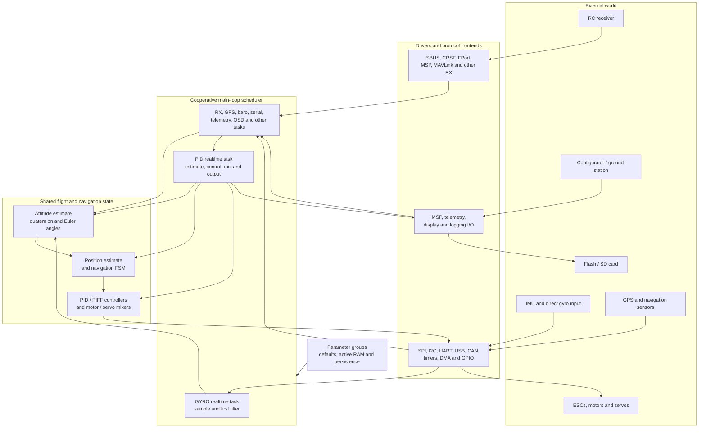

# INAV Firmware Architecture

> A source-grounded deep dive into [INAV](https://github.com/iNavFlight/inav): navigation-capable flight-controller firmware for multirotors, fixed-wing aircraft, VTOLs, rovers, boats, and other RC vehicles.

This documentation explains how the firmware is organized, how data moves through it, which modules own important state, and where contributors should make changes. It is written for experienced programmers; flight-control terms are explained in the [glossary](docs/00-glossary.md) and at their first important use.

**Source snapshot:** [`7c2ac359401a839d0d70b9514630919f94314ff9`](https://github.com/iNavFlight/inav/tree/7c2ac359401a839d0d70b9514630919f94314ff9), on the `maintenance-10.x` branch, identifying itself as INAV **10.0.0** in [`CMakeLists.txt`](https://github.com/iNavFlight/inav/blob/7c2ac359401a839d0d70b9514630919f94314ff9/CMakeLists.txt#L56). All source links in this analysis point to that pinned tree. Paths written as `src/main/...` are relative to the `inav/` repository root.

## Document map

| # | Document | What it explains |
|---|---|---|
| 0 | [Glossary](docs/00-glossary.md) | Flight-control, navigation, embedded, protocol, and INAV-specific terms |
| 1 | [Architecture Overview](docs/01-architecture-overview.md) | Layers, directory map, dependencies, state ownership, and recurring design patterns |
| 2 | [Platforms & Drivers](docs/02-platforms-and-drivers.md) | Board abstraction, bus/device registries, MCU backends, memory, timers, and serial interfaces |
| 3 | [Boot, Scheduler & Main Loop](docs/03-boot-and-scheduler.md) | Reset-to-ready initialization, task selection, realtime tasks, callbacks, and timing |
| 4 | [Sensors & Attitude Estimation](docs/04-sensors-and-estimation.md) | Sensor frontends, calibration, filtering, health, frames, GPS, and the Mahony AHRS |
| 5 | [Flight-Control Pipeline](docs/05-flight-control.md) | RC commands, angle/rate controllers, PID/PIFF, mixers, servos, and actuator outputs |
| 6 | [Navigation & Missions](docs/06-navigation-and-missions.md) | Position estimation, navigation FSM, holds, RTH, waypoint missions, geozones, launch, and landing |
| 7 | [RC, Serial & Communications](docs/07-communications.md) | Receiver protocols, RC ownership, serial allocation, MSP, telemetry, and MAVLink |
| 8 | [OSD, Logging & Programming](docs/08-osd-logging-and-programming.md) | Displayports, CMS, Blackbox, logic conditions, storage, USB MSC, and peripheral I/O |
| 9 | [Configuration & Persistence](docs/09-configuration-and-persistence.md) | Parameter groups, settings generation, EEPROM format, profiles, defaults, and save/load behavior |
| 10 | [Build, Targets & Testing](docs/10-build-targets-and-testing.md) | CMake composition, target variants, generated code, SITL, artifacts, and test architecture |
| 11 | [Extending INAV](docs/11-extending-inav.md) | Practical contributor recipes for tasks, drivers, settings, protocols, boards, and ports |

## The system at a glance

INAV is a **statically composed embedded C application**, not a set of independently running services. Board features are selected at compile time. At runtime, one cooperative scheduler runs tasks to completion; interrupts and DMA handle low-level I/O, while shared statically allocated state connects sensor processing, estimation, control, communications, and logging.



The diagram is a dependency view, not a claim that every arrow is a direct function call. In particular, navigation and PID control execute inside the PID task, while sensor topics can be updated by other scheduled tasks.

## Five ideas that explain most of the code

1. **The scheduler is cooperative and runs at most one registered task per pass.** “Realtime” is a priority class, not preemptive hard real time. See [Boot, Scheduler & Main Loop](docs/03-boot-and-scheduler.md).
2. **Gyro acquisition and the main control loop are separate tasks.** The gyro task samples and applies the first filter; the PID task performs later filtering, attitude estimation, navigation, control, mixing, and output writes.
3. **The main control path uses shared state rather than messages.** Important handoffs include `rcCommand[]`, `gyro.gyroADCf[]`, `attitude`, `posEstimator`, `posControl`, `axisPID[]`, `motor[]`, and `servo[]`.
4. **Board support is compile-time composition.** `target.h`, `target.c`, CMake target factories, MCU-specific backends, and linker scripts produce a separate executable for each board variant.
5. **Persistent configuration is discovered through linker registries.** Parameter-group macros register active storage and defaults; a generic serializer writes every registered group. `settings.yaml` adds CLI/MSP metadata but does not define persistence.

## Repository layout

```text
inav/
├── CMakeLists.txt             # Toolchain, language, version and platform entry point
├── cmake/                     # Target factories and MCU/host build definitions
├── lib/main/                  # Vendored CMSIS, vendor HALs, MAVLink, DroneCAN, Pico SDK
├── src/
│   ├── main/
│   │   ├── main.c             # init(), then scheduler() forever
│   │   ├── fc/                # Initialization, core loop, task wiring, CLI and MSP handlers
│   │   ├── scheduler/         # Cooperative scheduler and protothreads
│   │   ├── flight/            # IMU, PID/PIFF, mixers, failsafe and filters
│   │   ├── navigation/        # Position estimation, FSM, RTH, WP, launch and geozones
│   │   ├── sensors/           # Detection, calibration, processing and health
│   │   ├── drivers/           # Generic contracts, device drivers and MCU backends
│   │   ├── rx/                # Receiver protocol frontends/backends
│   │   ├── io/                # GPS, serial functions, OSD, storage and peripheral I/O
│   │   ├── msp/               # MSP wire transport; FC command handlers live in fc/
│   │   ├── mavlink/           # Routed MAVLink runtime, streams, missions and commands
│   │   ├── telemetry/         # Telemetry protocol implementations
│   │   ├── blackbox/          # Flight-log encoding and device output
│   │   ├── cms/               # Configuration menu system
│   │   ├── programming/       # Logic conditions, global variables and programming PIDs
│   │   ├── config/            # Parameter groups, EEPROM and storage streaming
│   │   ├── target/            # Board definitions, common hardware and linker scripts
│   │   ├── startup/           # Reset/vector code
│   │   └── common/            # Math, filters, buffers, time and encoding utilities
│   ├── bl/                    # Separate firmware-update bootloader
│   ├── test/                  # Native unit tests and SITL/integration harnesses
│   └── utils/                 # Settings, GPIO, image and documentation generators
├── docs/                      # Upstream user and developer documentation
├── board/                     # OpenOCD configurations, not firmware target definitions
└── dev/                       # Development support such as SVD files
```

See the [detailed directory and module map](docs/01-architecture-overview.md#directory-and-module-map).

## Snapshot statistics

These are static source-tree counts, not claims that every file is included in every firmware image:

- `src/main/`: **876 C files** and **694 headers**.
- Board composition: **316 ARM target-factory invocations** plus one SITL target. A target factory can produce several variants from one board directory.
- Native tests: **47 active `*_unittest.cc` programs**; additional integration harnesses live outside that naming pattern.
- Languages and toolchain: C99 for normal embedded builds, C11 where required by host/RP2350 builds, C++11 tests, CMake, and `arm-none-eabi` GCC for ARM firmware.

Feature gates mean that a source file or target's presence does not imply that its functionality is active in a particular build.

## Reading paths

| If you want to understand or change… | Start here |
|---|---|
| The whole architecture | [Architecture Overview](docs/01-architecture-overview.md), then [Boot & Scheduler](docs/03-boot-and-scheduler.md) |
| Gyro filtering or attitude estimation | [Sensors & Attitude Estimation](docs/04-sensors-and-estimation.md) |
| PID tuning code, mixing, motors, or servos | [Flight-Control Pipeline](docs/05-flight-control.md) |
| Position Hold, RTH, or waypoint missions | [Navigation & Missions](docs/06-navigation-and-missions.md) |
| Receiver decoding, MSP, telemetry, or MAVLink | [RC, Serial & Communications](docs/07-communications.md) |
| OSD, Blackbox, or logic conditions | [OSD, Logging & Programming](docs/08-osd-logging-and-programming.md) |
| A persistent setting | [Configuration & Persistence](docs/09-configuration-and-persistence.md), then [Extending INAV](docs/11-extending-inav.md) |
| A new flight-controller board | [Platforms & Drivers](docs/02-platforms-and-drivers.md), [Build & Targets](docs/10-build-targets-and-testing.md), and the [board-port recipe](docs/11-extending-inav.md#add-a-board-on-an-existing-mcu-family) |
| A new MCU family | [Platform portability contracts](docs/02-platforms-and-drivers.md#portability-contracts) and the [MCU-port recipe](docs/11-extending-inav.md#port-a-new-mcu-family) |

## Documentation conventions

- **Plain-English first:** major sections begin with a short mental model before implementation details.
- **Nominal rates are not guarantees:** scheduler periods are desired periods. Actual timing depends on cooperative execution and, for some drivers, runtime rescheduling.
- **Units are part of an interface:** INAV uses centimetres, centidegrees, decidegrees, degrees per second, radians per second, and PWM-like values in different modules. Check the tables in each deep dive.
- **State names are precise:** sensor detection, sensor health, calibration, GPS communication, GPS fix, arming, motor-stop, and output-enable are different states.
- **Diagrams are deliberately focused:** they show architecture and ownership, not every conditional compilation branch or function call.
- **Safety:** this is architecture documentation, not a flight-tuning or operating guide. Changes to control, arming, failsafe, output, or navigation code require appropriate simulation, testing, and hardware validation.
