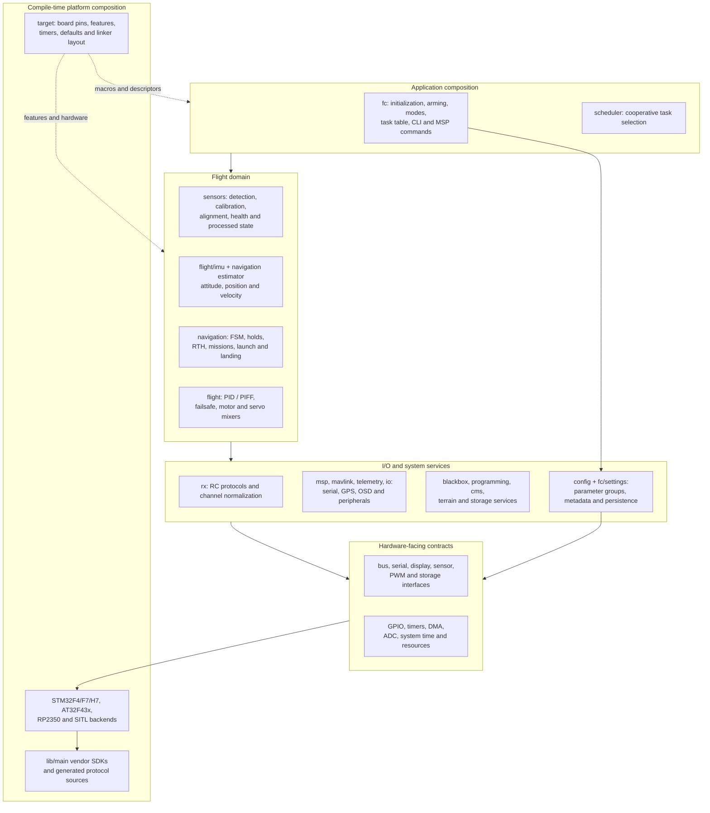
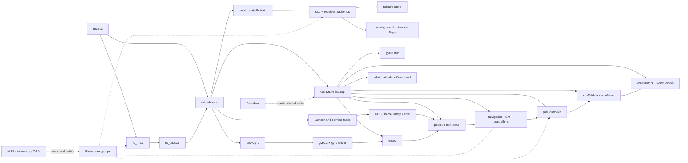
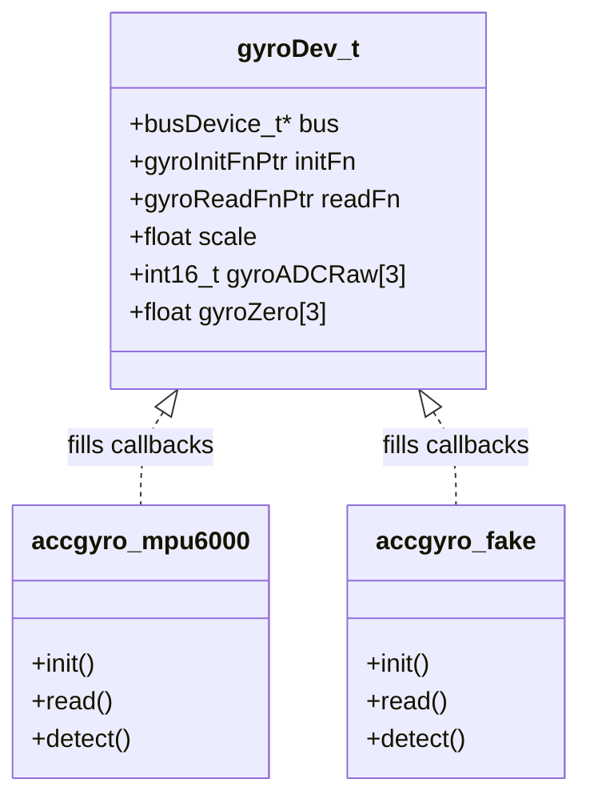
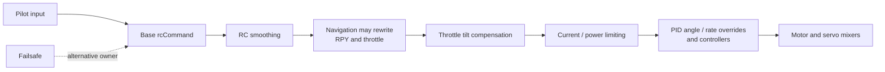

# 01 · Architecture Overview

High-level layering, module relationships, state ownership, execution contexts, and the design patterns that recur throughout INAV.

**[← Back to index](../README.md)** · Next: [02 · Platforms & Drivers](02-platforms-and-drivers.md)

---

## What INAV is

INAV is flight-controller firmware with navigation as a first-class part of the control system. It supports manually piloted and autonomous operation on multirotors, airplanes, flying wings, VTOL configurations, rovers, boats, and experimental mixer layouts. Its feature set includes attitude stabilization, altitude and position hold, Return to Home (RTH), waypoint missions, fixed-wing launch and landing logic, OSD, telemetry, Blackbox logging, and user-programmable logic.

The project evolved from Cleanflight/Baseflight. That heritage explains an important difference from library-centered autopilot projects: INAV is primarily **one C application composed from many source directories**, with static objects and function-pointer interfaces, rather than a collection of independently instantiable C++ subsystem objects.

## Architectural layers

### Layer responsibilities

| Layer | Main directories | Responsibility | Important boundary |
|---|---|---|---|
| Application composition | `fc/`, `scheduler/` | Boot, global flags, task registration, pilot/arming policy, command dispatch | Owns when major subsystems run; does not hide their shared state behind a message bus |
| Sensor and estimation | `sensors/`, `flight/imu.c`, `navigation/navigation_pos_estimator*` | Convert hardware samples into calibrated physical quantities and state estimates | Driver-specific data becomes common units and coordinate frames here |
| Control and autonomy | `flight/`, `navigation/` | Convert pilot or autonomous objectives into attitude, rate, throttle, motor, and servo demands | Navigation writes the same `rcCommand[]` interface used by pilot/failsafe processing |
| I/O and services | `rx/`, `io/`, `msp/`, `mavlink/`, `telemetry/`, `blackbox/`, `cms/`, `programming/` | Move data to/from the outside world and provide user-facing services | Protocol frontends normalize data before core modules consume it |
| Configuration | `config/`, `fc/settings.*`, `fc/config.c` | Own persistent structures, defaults, validation, profiles, and storage | Parameter groups persist data; generated settings expose selected fields to CLI/MSP |
| Hardware contracts | `drivers/`, `config/config_streamer.*` | Abstract buses, serial ports, timers, outputs, displays, sensors, and storage | Function pointers and C structs provide runtime driver substitution |
| Platform composition | `target/`, `startup/`, `cmake/`, `lib/main/` | Select board features and implement contracts for an MCU or host | A separate build compiles shared code with board- and MCU-specific definitions |

## Major dependency graph

### Dependency interpretation

- The arrows show principal data or control dependencies, not strict include-layer rules. C modules often include headers across these conceptual layers.
- **There is no independent navigation task.** Sensor tasks publish navigation topics, while estimation and navigation control run inside `taskMainPidLoop()` ([`fc_core.c:988-1097`](https://github.com/iNavFlight/inav/blob/7c2ac359401a839d0d70b9514630919f94314ff9/src/main/fc/fc_core.c#L988-L1097)).
- **There is no separate mixer task.** PID, motor mixing, servo mixing, and output writes are sequential calls in the same PID task.
- Communications modules often read core state directly. This avoids copying large state snapshots but makes unit and initialization order important.

## Directory and module map

### Flight application and algorithms

| Path | Role | Key files or interfaces |
|---|---|---|
| `src/main/fc/` | Application composition and global policy | `fc_init.c`, `fc_core.c`, `fc_tasks.c`, `runtime_config.*`, `rc_controls.*`, `config.c`, `cli.c`, `fc_msp.c`, `settings.yaml` |
| `src/main/scheduler/` | Cooperative task scheduler and stackless continuations | `scheduler.*`, `protothreads.h` |
| `src/main/flight/` | Attitude estimation, controllers, mixing, failsafe, filtering | `imu.*`, `pid.*`, `mixer.*`, `servos.*`, `failsafe.*`, `power_limits.*`, `rpm_filter.*` |
| `src/main/navigation/` | Position estimation and autonomous flight | `navigation.c`, `navigation_private.h`, `navigation_pos_estimator*`, `navigation_multicopter.c`, `navigation_fixedwing.c`, `navigation_geo.c`, `rth_trackback.*` |
| `src/main/sensors/` | Hardware-independent sensor processing | `gyro.*`, `acceleration.*`, `compass.*`, `barometer.*`, `initialisation.c`, `diagnostics.*` |
| `src/main/terrain/` | Terrain data and terrain-I/O support | Scheduled separately from the main navigation estimator; consumed when terrain following is enabled |

### Input, output, and protocols

| Path | Role | Key files or interfaces |
|---|---|---|
| `src/main/rx/` | Receiver protocol selection, frame decoding, channel validation | `rx.*`, `sbus.c`, `crsf.c`, `fport*.c`, `srxl2.c`, `msp.c`, `mavlink.c` |
| `src/main/io/` | GPS, serial-function allocation, OSD, storage, VTX, and peripheral protocols | `gps.*`, `serial.*`, `osd.*`, `displayport_*`, `flashfs.*`, `asyncfatfs/` |
| `src/main/msp/` | MSP wire parser and serial transport | `msp_serial.*`, protocol headers |
| `src/main/mavlink/` | MAVLink routing, streams, commands, missions, and guided input | `mavlink_runtime.c`, `mavlink_routing.c`, `mavlink_streams.c`, `mavlink_mission.c` |
| `src/main/telemetry/` | Telemetry state and protocol handlers | `telemetry.*`, `crsf.c`, `smartport.c`, `ltm.c`, `mavlink.c` |
| `src/main/blackbox/` | Flight-data snapshots, encoding, and output devices | `blackbox.*`, `blackbox_io.*`, `blackbox_encoding.*` |
| `src/main/cms/` | Declarative configuration menus and display ownership | `cms.*`, `cms_types.h` |
| `src/main/programming/` | Logic conditions, global variables, and programming PID controllers | `logic_condition.*`, `global_variables.*`, `pid.*` |
| `src/main/msc/` | USB mass-storage service and flash-backed virtual FAT | `emfat_file.c`, storage glue |

### Platform and infrastructure

| Path | Role | Key files or interfaces |
|---|---|---|
| `src/main/drivers/` | Generic contracts, device drivers, and MCU implementations | `bus.*`, `serial.*`, `timer.*`, `pwm_output.*`, `accgyro/`, `barometer/`, `compass/` |
| `src/main/config/` | Persistent registration, EEPROM records, and storage backends | `parameter_group.*`, `config_eeprom.*`, `config_streamer.*` |
| `src/main/common/` | Platform-neutral utilities | `maths.*`, `filter.*`, `calibration.*`, `streambuf.*`, `time.*`, `encoding.*` |
| `src/main/build/` | Build assertions, sections, and test visibility | `build_config.h`, `debug.*`, `version.c` |
| `src/main/target/` | Board features, pin/bus maps, common defaults, and linker scripts | `common.h`, `common_post.h`, `common_hardware.c`, `TARGETNAME/`, `link/` |
| `src/main/startup/` | MCU reset and vector code | Family-specific assembly |
| `cmake/` | Build target factories and platform source lists | `main.cmake`, `stm32*.cmake`, `at32*.cmake`, `rp2350.cmake`, `sitl.cmake` |
| `src/test/` | Native unit and integration tests | `unit/`, `mavlink/` |
| `src/utils/` | Host-side generators and image utilities | `settings.rb`, `def_generated.pl`, `update_cli_docs.py` |

## Execution contexts

INAV has no general-purpose RTOS task per subsystem. Work occurs in several distinct contexts:

| Context | Examples | Consequence |
|---|---|---|
| Interrupt and DMA driver context | UART byte reception, timer/DMA completion, hardware sampling notifications | Keep work short; publish flags or buffers for later processing |
| Cooperative scheduler context | GYRO, PID, RX, GPS, serial, baro, telemetry, OSD | A running task is not preempted by another scheduler task |
| Realtime-callback context | DShot completion, ESC telemetry polling, AsyncFatFS polling | Runs after idle scheduler passes and after forced realtime tasks; callbacks must self-limit work |
| Special blocking service context | USB mass storage, serial/GPS passthrough, ESC 4-way programming | Normal scheduling or normal port ownership can be intentionally suspended |
| Host SITL threads | TCP serial receive helpers and simulator integration | Host convenience, not a second flight-control pipeline |

The main C loop is only a few lines: call `init()`, then repeatedly call `scheduler()` ([`main.c:61-78`](https://github.com/iNavFlight/inav/blob/7c2ac359401a839d0d70b9514630919f94314ff9/src/main/main.c#L61-L78)). Complexity lives in task composition and shared state, not in `main()`.

## Core state ownership

INAV's public interfaces often combine functions with externally visible static state. Treat the following as architectural handoff points.

| State | Primary owner | Principal writers | Principal consumers |
|---|---|---|---|
| `rcChannels[]` | `rx/rx.c` | Receiver normalization and validation | RC mapping, modes, failsafe, command generation |
| `rcCommand[4]` | `fc/rc_controls.c` | Pilot/failsafe processing, smoothing, navigation, throttle compensation and limiting | PID target generation and motor/servo mixers |
| `isRXDataNew` | `fc/fc_core.c` | RX task sets; PID task clears | Coalescing notification that RX processing ran |
| `gyro` and `gyro.gyroADCf[]` | `sensors/gyro.c` | GYRO sampling and PID-rate filtering | IMU, PID, logging, telemetry |
| `orientation`, `rMat`, `attitude` | `flight/imu.c` | Attitude estimator | Navigation, angle/heading control, OSD, arming |
| `posEstimator` | Navigation estimator | GPS, IMU, baro, surface and flow topic handlers plus predictor/corrector | Publication into `posControl.actualState` |
| `posControl` | `navigation/navigation.c` and platform controllers | FSM, estimator publication, mission/RTH state | Navigation controllers and public telemetry interfaces |
| `armingFlags`, `flightModeFlags`, `stateFlags` | `fc/runtime_config.c` | RX, arming, failsafe, navigation, and other policy code | Almost every flight-domain module |
| `axisPID[3]` | `flight/pid.c` | Selected rate controller | Motor and servo mixers, Blackbox |
| `motor[]`, `servo[]` | `flight/mixer.c`, `flight/servos.c` | Mixers and output scaling | Output backends and logging |
| Active PG storage | Each registering module | CLI/MSP/special setters and runtime initialization | Runtime modules and the generic EEPROM serializer |
| `gpsSolDRV` → `gpsSol` | `io/gps.c` | Provider fills private driver copy; GPS frontend publishes complete solution | Navigation, IMU heading, telemetry, OSD |

### Handshake and freshness implications

- `isRXDataNew` is a Boolean, not a queue. Multiple RX updates can coalesce before a PID run. It also means “the RX task ran,” not necessarily “a fresh receiver frame arrived.”
- The GYRO and PID tasks share the current gyro arrays without a scheduler-enforced sample sequence. A failed gyro read can leave the previous value in place.
- `gpsSolDRV` and `gpsSol` form an explicit publication boundary: drivers fill the former, and only complete solutions are copied to the latter ([`gps.c:363-428`](https://github.com/iNavFlight/inav/blob/7c2ac359401a839d0d70b9514630919f94314ff9/src/main/io/gps.c#L363-L428)).
- Global bitfields are appropriate for this single cooperative flight context, but interrupt-facing writers still need deliberate atomicity. Do not assume the macros themselves provide synchronization.

## Recurring design patterns

### 1. Compile-time feature and board composition

`USE_*` macros include code and hardware support; `FEATURE_*` bits select configured runtime behavior. Board headers are included through `platform.h`, and target factories create separate executables. This is how one source tree fits very different flash, RAM, and peripheral budgets.

**Invariant:** compiling a driver does not prove that its hardware was detected or that its runtime feature is enabled. Check all three layers: compilation, configuration/detection, and per-run state guards.

### 2. Device structures with function-pointer vtables

Sensors, serial ports, displays, output protocols, and storage backends expose a C structure containing state plus function pointers. Detection or initialization binds the implementation.

This is runtime polymorphism without C++ objects. It does **not** automatically make drivers reentrant or multi-instance-safe; many use file-static state.

### 3. Conditional driver detection

`sensorsAutodetect()` tries enabled sensor classes in sequence. Concrete detection functions probe hardware, fill device callbacks, and update requested/detected sensor metadata ([`initialisation.c:47-115`](https://github.com/iNavFlight/inav/blob/7c2ac359401a839d0d70b9514630919f94314ff9/src/main/sensors/initialisation.c#L47-L115)). Higher-level code consumes a common frontend rather than chip-specific data.

### 4. Linker-discovered registries

Parameter groups and board bus devices are emitted into named sections. Start/end linker symbols let generic code iterate them without a central hand-maintained list.

- `.pg_registry` and `.pg_resetdata`: configuration records and defaults.
- `.busdev_registry`: static board bus-device descriptors.

**Porting invariant:** a new linker script must preserve these sections and symbols, not only normal code and data.

### 5. Static ownership rather than dynamic allocation

Most flight state, device state, filters, task records, and configuration storage are statically allocated. Section attributes such as `FASTRAM`, `FAST_CODE`, and `DMA_RAM` place performance- or DMA-sensitive objects appropriately.

Benefits include predictable memory use and no flight-time allocator dependency. Costs include tight coupling, careful initialization order, and limited reentrancy.

### 6. Cooperative tasks plus event checks

A `cfTask_t` can have a normal `taskFunc`, an optional `checkFunc`, a desired period, and a static priority. RX is the canonical event-driven task: its check notices a complete frame or timeout, and the scheduler later invokes its main function.

### 7. Protothreads for sequential device state machines

GPS configuration, pitot sampling, and other long-lived protocols use stackless protothreads. They make sequential wait/resume logic compact without allocating a thread stack. Locals do not persist across a protothread wait unless stored elsewhere, and protothreads run only when their containing task drives them.

### 8. Frontend normalization and private-to-public publication

Examples include:

- receiver backend → validated `rcChannels[].data`;
- GPS provider → `gpsSolDRV` → public `gpsSol`;
- sensor driver → calibrated aligned sample → common sensor state;
- Blackbox core state → encoded frames → serial/flash/SD backends.

The public side is shielded from protocol and bus details, but not necessarily from shared mutable state.

### 9. Generated metadata around handwritten data

`settings.yaml` generates compact setting metadata, names, ranges, and default macros. Handwritten C still owns PG structures, registration, and reset behavior. Blackbox similarly separates field declarations from encoding code, but there the writer must exactly match the declared order and predictors.

## Control ownership and call order

There is no single immutable “setpoint” object with built-in arbitration. The effective precedence comes from call order in the PID task:

A later stage can modify or replace an earlier command. Programming-framework helpers add overrides at specific interfaces rather than through one global priority scheme. When changing this sequence, review every writer and consumer of `rcCommand[]`.

## Cross-cutting invariants and pitfalls

1. **Cooperative scheduling is not a deadline system.** A long task delays every later task; execution statistics do not enforce a budget.
2. **Desired period is not measured period.** Use actual task deltas for time-dependent control; the PID task already does this.
3. **Disarming does not stop the scheduler or PID task.** Safe motor values are selected in the mixer; servo processing can continue.
4. **Armed does not necessarily mean motors rotate.** Motor-stop and navigation idle/stop requests are separate policy.
5. **Units change at boundaries.** Examples: gyro filtering uses degrees/second, IMU integration uses radians/second, attitude uses decidegrees, navigation yaw often uses centidegrees, and local position uses centimetres.
6. **Positive pitch is down in the public attitude convention.** This affects fixed-wing guidance and command conversion.
7. **Detection, health, calibration, and validity are distinct.** For example, GPS communication sets `SENSOR_GPS`; a usable position sets `GPS_FIX`.
8. **`FIXED_WING_LEGACY` includes rover and boat.** Use `AIRPLANE` when logic truly applies only to airplanes.
9. **Function pointers are initialized state.** Do not switch an output protocol or device backend merely by changing its live configuration field.
10. **Static configuration layouts are an ABI.** PG version, structure packing, linker sections, and generated target-specific settings must stay consistent.
11. **Shared state is not a generic thread-safe API.** Review execution context before accessing it from interrupts, host threads, or new asynchronous code.
12. **Feature-specific documentation must be read conditionally.** Diagrams in this package show available paths; a target may compile them out.

## Navigation

**[← Back to index](../README.md)** · Next: [02 · Platforms & Drivers](02-platforms-and-drivers.md)
