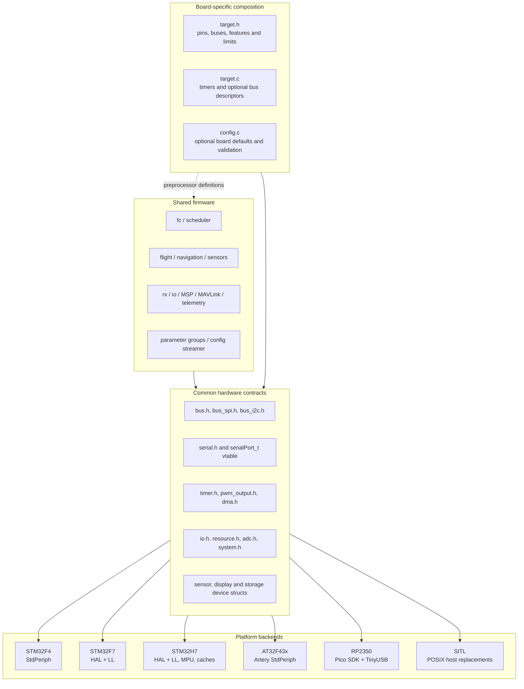
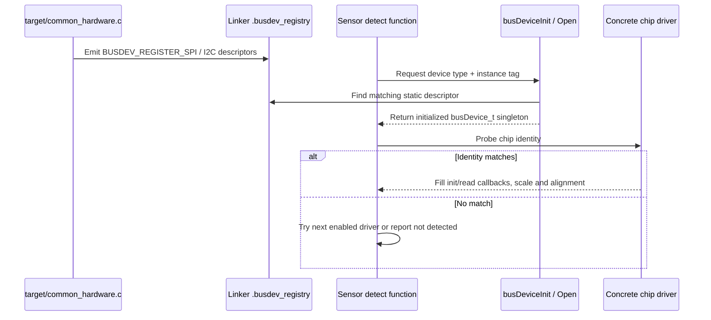
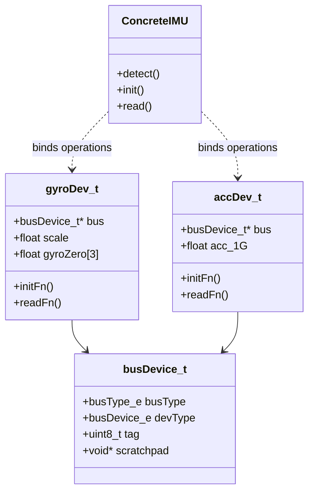

# 02 · Platforms & Drivers

How INAV presents one set of hardware-facing contracts to shared flight code while compiling different board descriptions, MCU backends, startup code, and memory layouts.

**[← Back to index](../README.md)** · Previous: [01 · Architecture Overview](01-architecture-overview.md) · Next: [03 · Boot, Scheduler & Main Loop](03-boot-and-scheduler.md)

---

## The model in one sentence

INAV uses **compile-time board composition plus runtime function-pointer drivers**: shared flight code includes common hardware contracts, each firmware target supplies macros and static descriptors for one board, and initialization binds those contracts to concrete MCU or device implementations.

This is not a runtime plugin system. A firmware image contains only the board variant and MCU backend selected by its build.

## Platform composition

The include order in [`platform.h:20-89`](https://github.com/iNavFlight/inav/blob/7c2ac359401a839d0d70b9514630919f94314ff9/src/main/platform.h#L20-L89) is itself an architectural contract:

1. Select MCU-family types and vendor headers.
2. Include `target/common.h` for baseline defaults.
3. Include the selected board's `target.h` for overrides and hardware.
4. Apply legacy sanity checks.
5. Include `target/common_post.h` for derived defaults and resource gates.

Changing that order can change which features exist, which defaults win, and whether shared code compiles.

## Portability contracts

| Contract | Interface shape | Responsibility |
|---|---|---|
| GPIO and resources | Packed `IO_TAG()`, `IO_t`, `IOInit()`, resource owner metadata | Convert board pin tags into runtime pin records and configure them |
| Bus devices | `busDevice_t`, linker registry descriptors, `busDeviceInit/Open()` | Bind a chip driver to an I²C/SPI instance and shared device state |
| Bus transactions | `busRead*()`, `busWrite*()`, `busTransfer()` | Hide I²C/SPI dispatch, chip select, and register-bit conventions |
| Serial | `serialPort_t` plus function-pointer vtable | Provide UART, VCP, TCP, softserial, and other ports through one API |
| Timers and DMA | `timerHardware_t`, `DEF_TIM`, timer implementation calls | Map board pins/channels to MCU timers and DMA options |
| Motor/servo output | `pwmWriteMotor()`, `pwmWriteServo()`, completion hooks | Separate mixer values from analog/digital/serial output protocols |
| Sensor devices | Device structs with init/read/update callbacks | Normalize chip drivers behind gyro, accel, mag, baro, range, and pitot frontends |
| Display | `displayPort_t` vtable | Hide character, pixel, MSP, OLED, and text displays from OSD/CMS |
| System | `systemInit()`, reset, bootloader, persistent state, `micros()` and delays | Supply clocks, reset behavior, time, and reset diagnostics |
| Configuration storage | `config_streamer` unlock/write/lock operations | Stream one EEPROM image to internal flash, external flash, RAM, or a host file |

The portability boundary is deliberately pragmatic. Some shared code still uses MCU conditionals, memory attributes, or vendor types; INAV does not attempt to hide every hardware difference behind one large HAL object.

## Board definition anatomy

A typical `src/main/target/BOARD/` contains:

| File | Purpose |
|---|---|
| `target.h` | Board identifier, feature macros, pin mappings, buses, sensor selections, ADC assignments, UARTs, storage, output limits, and IO-port masks |
| `target.c` | `timerHardware[]`, timer count, and optional explicit bus-device descriptors |
| `CMakeLists.txt` | One or more target-factory invocations; required for automatic board discovery |
| `config.c` | Optional `targetConfiguration()` defaults and `validateAndFixTargetConfig()` hooks |
| `hardware_setup.c` / `hardware_revision.c` | Optional preboot power/mux setup and board-revision handling |

One directory can produce multiple variants. For example, a variant macro can select different storage or I²C layouts while reusing the rest of the target description ([`MATEKF405/target.h:56-72`](https://github.com/iNavFlight/inav/blob/7c2ac359401a839d0d70b9514630919f94314ff9/src/main/target/MATEKF405/target.h#L56-L72)).

### Feature gates are not runtime features

- `USE_GPS`, `USE_MAG`, `USE_DSHOT`, and similar macros determine whether code is compiled.
- `FEATURE_GPS`, `FEATURE_OSD`, and similar PG bits determine configured behavior.
- Detection state determines whether physical hardware was found.
- Task/function guards determine whether work is valid at a particular moment.

All four questions may have different answers.

## GPIO and resource ownership

`IO_TAG(Pxy)` encodes a port and pin into a compact tag. Target IO masks determine which records exist, and `IOGetByTag()` resolves a tag into `ioRecs[]`. `IOInit()` records owner, resource, and index; electrical configuration is a separate step performed by `IOConfigGPIO()`, `IOConfigGPIOAF()`, or related functions ([`io.c:260-327`](https://github.com/iNavFlight/inav/blob/7c2ac359401a839d0d70b9514630919f94314ff9/src/main/drivers/io.c#L260-L327)).

The ownership fields are primarily **accounting and diagnostics**, not a universal lock. Basic `IOInit()` and DMA initialization do not automatically arbitrate every conflict. Higher-level mapping code must check timer, UART, ADC, LED, and output usage before assignment, and drivers must still perform the required GPIO configuration after claiming the record.

**Maintainer pitfall:** a successful pin initialization does not prove that its timer/DMA combination is valid or unused. Board review and target hardware testing remain necessary.

## Bus-device registry

The bus registry is a central abstraction for SPI/I²C-connected hardware. Board descriptions emit static descriptors into `.busdev_registry`; generic code finds a descriptor matching device type and tag.

### `busDevice_t` responsibilities

The descriptor and runtime object carry:

- bus type and hardware instance;
- device type and instance tag;
- I²C address or SPI chip-select details;
- optional IRQ pin and driver-specific parameter;
- runtime state and optional scratchpad shared by related drivers.

See [`bus.h:167-214`](https://github.com/iNavFlight/inav/blob/7c2ac359401a839d0d70b9514630919f94314ff9/src/main/drivers/bus.h#L167-L214) and [`bus.c:115-195`](https://github.com/iNavFlight/inav/blob/7c2ac359401a839d0d70b9514630919f94314ff9/src/main/drivers/bus.c#L115-L195).

`busDeviceInit()` performs initial matching and setup. `busDeviceOpen()` reuses an already initialized context, which lets an accelerometer share a combined IMU already opened by gyro detection. The scratchpad can hold one combined accel/temperature/gyro transaction so two frontends need not perform duplicate bus reads.

### Common versus explicit descriptors

`target/common_hardware.c` converts common `USE_IMU_*`, `USE_BARO_*`, `USE_MAG_*`, flash, and display macros into registry entries. Boards with unusual layouts can provide explicit descriptors and override the corresponding common set.

Do not enable both common and explicit descriptions for the same device unintentionally; registry matching expects a coherent board-level hardware map.

## Device-driver pattern

Most chip drivers follow this sequence:

1. A board macro includes the driver in the build and describes its bus/CS/address/alignment.
2. The sensor frontend calls the driver's detect/probe function.
3. The driver opens the `busDevice_t`, checks chip identity, and initializes hardware.
4. On success it fills a device structure's callbacks and physical scale.
5. Scheduled frontend calls use those callbacks and normalize the result.

For the actual layouts, see [`accgyro.h:39-65`](https://github.com/iNavFlight/inav/blob/7c2ac359401a839d0d70b9514630919f94314ff9/src/main/drivers/accgyro/accgyro.h#L39-L65). Equivalent patterns exist for compass, barometer, rangefinder, and pitot devices.

### Static does not mean reentrant

The vtable shape suggests replaceable objects, but many frontends and drivers keep singleton or file-static state. Adding a second instance requires more than allocating another device struct: review scratchpads, calibration, filters, static driver variables, and public arrays. INAV's dual-gyro support is a specific implementation, not proof that every sensor stack is arbitrarily multi-instance.

## Timers, DMA, and output mapping

Each board exposes `timerHardware[]` and `timerHardwareCount`. `DEF_TIM` expands through MCU-specific definitions into timer/channel/DMA metadata. Runtime timer code connects those descriptors to implementation functions.

PWM mapping then performs higher-level allocation:

- determine required motors and servos across **all mixer profiles**;
- avoid assigning a motor and servo to the same timer;
- skip hardware timers for serial output protocols when appropriate;
- check configured UART, softserial, LED, ADC, and timer-group conflicts;
- report insufficient outputs or initialization failures.

The mapping logic is in [`pwm_mapping.c:324-410`](https://github.com/iNavFlight/inav/blob/7c2ac359401a839d0d70b9514630919f94314ff9/src/main/drivers/pwm_mapping.c#L324-L410) and [`pwm_mapping.c:424-525`](https://github.com/iNavFlight/inav/blob/7c2ac359401a839d0d70b9514630919f94314ff9/src/main/drivers/pwm_mapping.c#L424-L525).

### Output protocol strategy

`pwm_output.c` holds motor and servo writer function pointers. Initialization selects standard PWM, OneShot, Multishot, brushed, DShot, SRXL2, servo PWM, or servo SBUS implementations. `writeMotors()` stages commands; digital protocols can complete packetization and DMA later through `pwmCompleteMotorUpdate()`.

The initialized protocol is latched. A live configuration edit does not safely rebind hardware and function pointers; output protocol changes belong with save/reinitialization workflows.

## Serial abstraction

`serialPort_t` combines:

- RX/TX circular buffers;
- baud rate, mode, and options;
- an optional receive callback;
- a vtable for read/write, buffer status, reconfiguration, connection state, and optional bulk writes.

See [`drivers/serial.h:58-109`](https://github.com/iNavFlight/inav/blob/7c2ac359401a839d0d70b9514630919f94314ff9/src/main/drivers/serial.h#L58-L109).

UART, USB VCP, TCP SITL, and other implementations all expose this shape. Above it, `io/serial.c` assigns **functions** such as MSP, GPS, serial RX, telemetry, Blackbox, VTX, or displayport to configured ports and tracks ownership. See [RC, Serial & Communications](07-communications.md#serial-port-and-function-allocation).

**Backpressure invariant:** serial writes are not uniformly nonblocking. If no bulk-write implementation exists, the generic buffer writer can wait for space. Protocols with timing constraints must check TX capacity before writing.

## MCU and host backends

| Platform | Implementation model | Notable architectural details |
|---|---|---|
| STM32F4 | Cortex-M4F, ST Standard Peripheral Library, family-specific drivers | Common F405/F411/F427 targets; legacy USB/VCP path; CCM/FASTRAM layouts vary by MCU |
| STM32F7 | Cortex-M7, STM32 HAL plus selected LL drivers | Cache awareness, TCM/FASTRAM, bxCAN DroneCAN backend, shared HAL USB/storage code |
| STM32H7 | Cortex-M7, HAL/LL, more complex memory and bus domains | Multiple RAM regions, DMA placement constraints, MPU support, QuadSPI, FDCAN |
| AT32F43x | Cortex-M4F, Artery StdPeriph and USB stack | Separate AT32 peripheral, startup, linker, persistence, and debug support |
| RP2350 | Cortex-M33, Pico SDK and TinyUSB | INAV-shaped GPIO/bus/serial/PWM backends, PIO DShot, XIP flash config; limited/development board support in this snapshot |
| SITL | Native host C process with POSIX replacements | Same flight/control code, fake devices, TCP serial, host files, simulator adapters; not an ARM instruction emulator or hard-real-time environment |

The build modules select exact vendor sources rather than compiling entire SDK trees. See [Build, Targets & Testing](10-build-targets-and-testing.md).

### RP2350 scope in this snapshot

RP2350 support is real, not just stub files: it has build integration, startup/linker support, TinyUSB, GPIO, UART, I²C/SPI, ADC, PWM/DShot, persistence, and configuration backends. However, the checked-in `RP2350_PICO` target uses fake IMU/GPS/pitot/rangefinder inputs, and its board documentation identifies unverified end-to-end peripherals. Treat it as development/bench support rather than assuming feature parity with mature STM32 targets ([`RP2350_PICO.md:279-314`](https://github.com/iNavFlight/inav/blob/7c2ac359401a839d0d70b9514630919f94314ff9/docs/boards/RP2350_PICO.md#L279-L314)).

## Startup and linker-created architecture

Embedded startup code establishes the stack, initializes data and BSS regions, performs family-specific system setup, and enters `main()`. SITL enters the same shared `init()` through a host `main(argc, argv)`.

Linker scripts do more than place code:

| Symbol or section | Consumer | Why it matters |
|---|---|---|
| `__config_start`, `__config_end` | Configuration streamer | Defines the persistent configuration region |
| `.pg_registry` | Parameter-group iteration | Discovers every registered configuration group |
| `.pg_resetdata` | PG reset logic | Stores const reset templates and distinguishes them from reset-function pointers |
| `.busdev_registry` | Bus initialization | Discovers static board device descriptors |
| FASTRAM/TCM sections | Time-critical state and code | Places hot data/code in appropriate memory |
| DMA sections | Peripheral buffers | Ensures buffers are in memory the relevant DMA engine can access |

A representative layout is [`stm32_flash.ld:80-99`](https://github.com/iNavFlight/inav/blob/7c2ac359401a839d0d70b9514630919f94314ff9/src/main/target/link/stm32_flash.ld#L80-L99).

### Memory attributes are functional requirements

`FAST_CODE`, `FASTRAM`, `EXTENDED_FASTRAM`, `DMA_RAM`, and related macros must agree with the linker and platform. On H7 and other cache/DMA systems, a buffer can be linked successfully yet still be inaccessible or incoherent for the intended peripheral.

When moving a declaration, adding a large buffer, or porting a linker script, inspect the map file and actual memory-region capabilities. Do not treat these annotations as optional optimization hints.

## Initialization and ownership order

Hardware composition imposes a strict boot order:

1. Clocks, system state, and early board hooks.
2. Configuration load, because later hardware choices depend on it.
3. Timers, serial infrastructure, mixer/output counts, and output mapping.
4. Buses, ADC, and board hardware.
5. Sensor detection and calibration.
6. IMU, PID filters, failsafe, and RX.
7. Task registration and final-ready state.

The detailed call sequence is in [Boot, Scheduler & Main Loop](03-boot-and-scheduler.md). A driver must not assume that configuration, bus registry, time, or scheduler state exists before its documented initialization phase.

## Common platform pitfalls

1. **A target directory without `CMakeLists.txt` is not discovered.** `target.h` and `target.c` alone do not create a build.
2. **A driver filename is not proof of its feature-macro name.** Check the driver's guards and target documentation.
3. **Resource labels do not prevent every conflict.** Review pins, timers, DMA streams/channels, and shared timer groups together.
4. **Output counts must include inactive mixer profiles.** A later profile switch must not require unallocated outputs.
5. **Registry sections must survive linking and garbage collection.** Use the established `KEEP()` and start/end-symbol patterns.
6. **DMA accessibility differs by memory region.** Especially on F7/H7, map placement and cache maintenance are part of correctness.
7. **Do not blindly reuse a vendor shim.** RP2350 excludes incompatible shared backends instead of pretending STM32 register types are universal.
8. **Host success is not hardware validation.** Native tests and SITL cannot prove electrical signal shape, DMA behavior, sensor alignment, flash timing, or real-time performance.
9. **Configuration and toolchain setup can have source-tree side effects.** Review the build system's compiler-download behavior before treating an out-of-source configure as completely read-only; see [Build, Targets & Testing](10-build-targets-and-testing.md#build-system-cautions).
10. **Peripheral protocol state is initialized state.** Do not hot-swap a function pointer without reinitializing its backend and dependent resources.

## Navigation

**[← Back to index](../README.md)** · Previous: [01 · Architecture Overview](01-architecture-overview.md) · Next: [03 · Boot, Scheduler & Main Loop](03-boot-and-scheduler.md)
