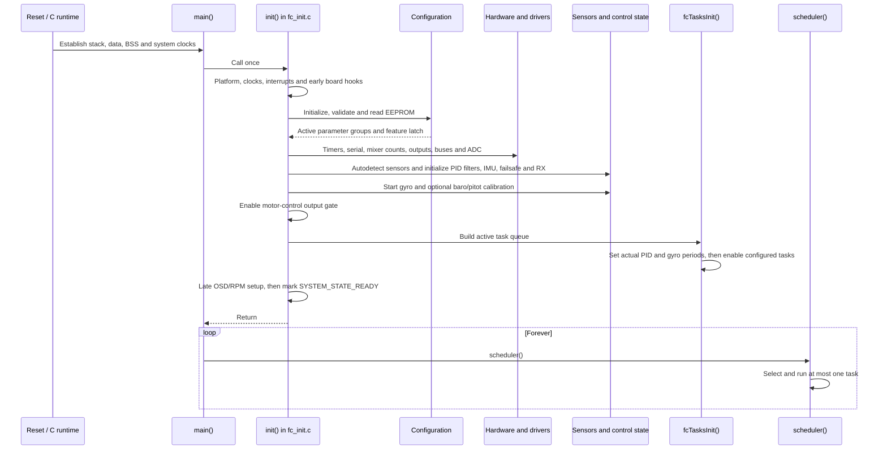
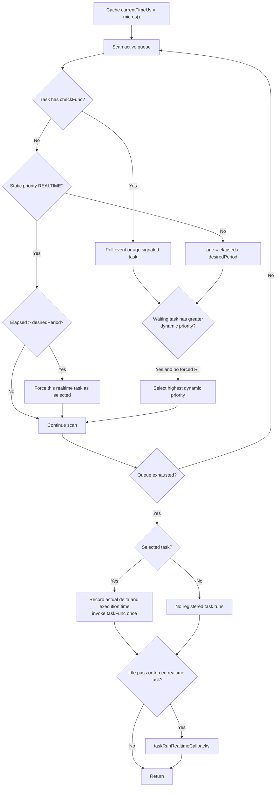
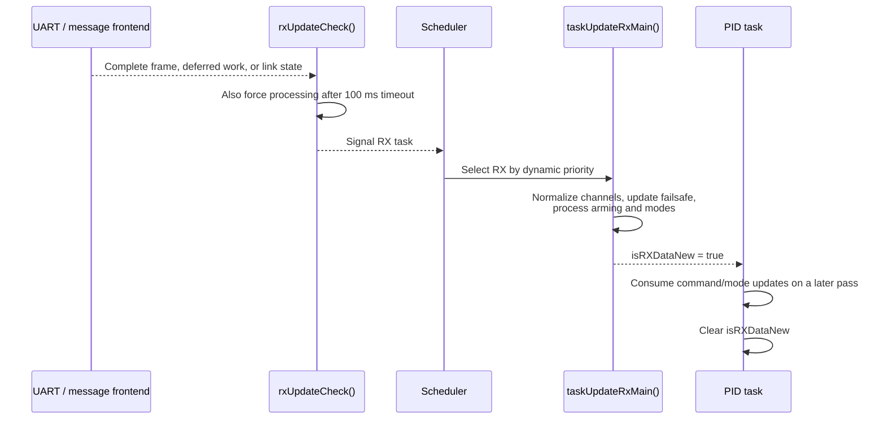
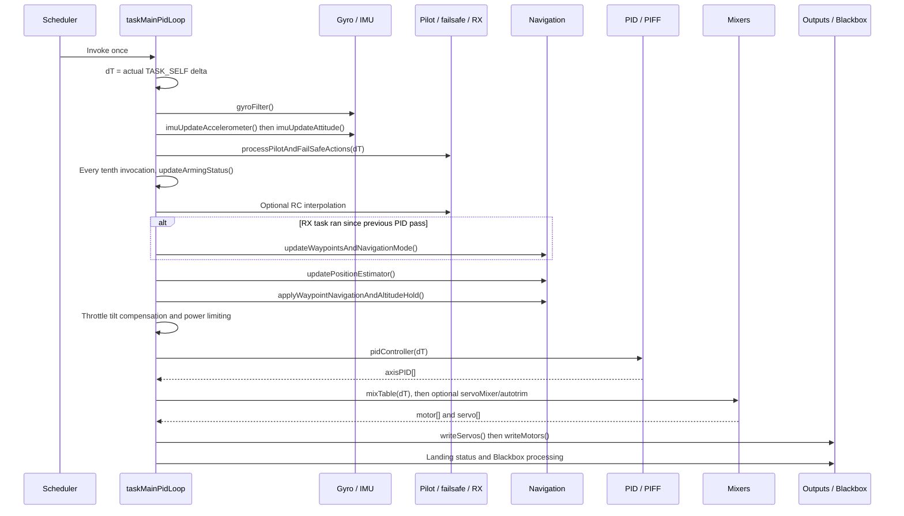

# 03 · Boot, Scheduler & Main Loop

How INAV gets from reset to a ready flight controller, then divides one CPU among flight-critical and background work without preemptive tasks.

**[← Back to index](../README.md)** · Previous: [02 · Platforms & Drivers](02-platforms-and-drivers.md) · Next: [04 · Sensors & Attitude Estimation](04-sensors-and-estimation.md)

---

## The model in one sentence

After a single blocking initialization sequence, `main()` repeatedly calls a **cooperative scheduler** that scans the active task queue, selects at most one registered task, runs it to completion, and sometimes services additional realtime callbacks.

“Realtime” in this scheduler means an overdue task gets selection preference. It does not mean preemption, a deadline guarantee, or an RTOS thread.

## Main entry point

Embedded builds define `main(void)`. SITL defines `main(int argc, char **argv)`, parses simulator arguments, and then follows the same shared path ([`main.c:61-78`](https://github.com/iNavFlight/inav/blob/7c2ac359401a839d0d70b9514630919f94314ff9/src/main/main.c#L61-L78)):

```text
main
 ├── init()
 ├── loopbackInit()                  # only active with softserial loopback
 └── while (true)
      ├── serialProxyProcess()       # SITL only
      ├── scheduler()
      └── processLoopback()          # softserial loopback only
```

No registered flight task runs until `init()` returns. Enabling tasks near the end of initialization only changes queue membership; it does not start concurrent execution.

## Boot and initialization sequence



### Initialization phases

| Phase | Important work | Why order matters |
|---|---|---|
| Platform and clocks | Optional HAL/preboot setup, reset `systemState`, system/CPU clocks, enable interrupts where applicable | Timing, buses, and drivers need a working platform |
| Configuration | Initialize/validate EEPROM, read PGs, suspend RX around storage work, latch features | Later initialization depends on configured hardware, protocols, and defaults |
| Early resources | Timer initialization, serial/MSP infrastructure, system work | Resource maps and port infrastructure must exist before users |
| Mixer and outputs | Select platform/mixer, determine output counts, initialize PWM mapping | Output allocation covers configured profiles and establishes output arming blockers |
| Buses and board hardware | Bus registry, I²C/SPI, ADC, PINIO, storage, USB-related setup | Sensor detection needs buses and power/resource setup |
| Sensor detection | `sensorsAutodetect()` and sensor readiness | Drivers bind device callbacks and publish detected-sensor state |
| Control state | PID filters, IMU, failsafe, RX, GPS provider | Control code depends on detected hardware and normalized configuration |
| Calibration | Start gyro and optional baro/pitot calibration | Gyro calibration subsequently progresses in scheduled gyro reads |
| Output gate | Set `motorControlEnable` | Separate from `ARMED`; permits the PID task to call motor-output code |
| Task construction | `fcTasksInit()` and late conditional OSD/RPM enablement | Installs actual loop periods and active queue before first scheduler pass |
| Ready | Clear reset reason, initialize statistics, set `SYSTEM_STATE_READY` | Exposes a complete initialization milestone |

The implementation is concentrated in [`fc_init.c:216-844`](https://github.com/iNavFlight/inav/blob/7c2ac359401a839d0d70b9514630919f94314ff9/src/main/fc/fc_init.c#L216-L844).

### `systemState` is not armed state

`systemState` records initialization milestones such as configuration ready, sensors ready, motors ready, and final ready. Arming, flight mode, and general runtime state use separate global bitfields. Do not use initialization readiness as a substitute for `ARMED`, sensor health, or calibration checks.

### Special boot modes

USB mass storage and some service operations intentionally depart from the normal scheduler path. For example, an MSC-requested boot prepares storage, starts the USB class, and waits in a service loop rather than running the normal flight scheduler. See [USB mass storage](08-osd-logging-and-programming.md#usb-mass-storage).

## Task representation

`cfTask_t`, declared in [`scheduler.h:164-183`](https://github.com/iNavFlight/inav/blob/7c2ac359401a839d0d70b9514630919f94314ff9/src/main/scheduler/scheduler.h#L164-L183), combines static definition and mutable scheduling state:

| Field group | Contents |
|---|---|
| Identity | `taskName` |
| Work | Optional `checkFunc`, required `taskFunc` for an enabled task |
| Timing policy | `desiredPeriod`, `staticPriority` |
| Selection state | `dynamicPriority`, `taskAgeCycles`, `lastExecutedAt`, `lastSignaledAt` |
| Measurement | `taskLatestDeltaTime`, moving execution-time sum, maximum and total execution time |

Static priorities are:

| Priority | Numeric value | Typical use |
|---|---:|---|
| `TASK_PRIORITY_IDLE` | 0 | Work that should yield to almost everything else |
| `TASK_PRIORITY_LOW` | 1 | Serial, OSD, filters, service tasks |
| `TASK_PRIORITY_MEDIUM` | 3 | Sensors and peripheral state machines |
| `TASK_PRIORITY_MEDIUM_HIGH` | 4 | Intermediate policy work |
| `TASK_PRIORITY_HIGH` | 5 | RX, AUX, system and output synchronization |
| `TASK_PRIORITY_REALTIME` | 18 | GYRO and PID |

The numeric value also affects aging: higher static priority makes dynamic priority grow faster with missed periods.

## Queue construction

`fcTasksInit()` first calls `schedulerInit()`, which clears the queue and inserts `TASK_SYSTEM`. It then reschedules and enables PID and GYRO using configured/driver-derived periods, and enables other compiled/configured tasks ([`fc_tasks.c:382-517`](https://github.com/iNavFlight/inav/blob/7c2ac359401a839d0d70b9514630919f94314ff9/src/main/fc/fc_tasks.c#L382-L517)).

The scheduler's private queue has three important properties:

- Entries are sorted by descending static priority; equal-priority insertion order is preserved.
- Enabling a task inserts it into the active queue; disabling removes it.
- Compile-time presence, queue membership, and per-function early-return guards are separate decisions.

Runtime enablement exists: OSD, RPM filtering, geozone-related behavior, and other modules can change queue state after initial construction when their preconditions are satisfied.

## One scheduler pass



The implementation is [`scheduler.c:237-348`](https://github.com/iNavFlight/inav/blob/7c2ac359401a839d0d70b9514630919f94314ff9/src/main/scheduler/scheduler.c#L237-L348).

## Time-driven task aging

For an ordinary periodic task:

```text
taskAgeCycles  = elapsedSinceLastRun / desiredPeriod
dynamicPriority = 1 + staticPriority × taskAgeCycles    when age > 0
```

The scheduler selects the waiting task with the greatest dynamic priority. Strict `>` comparison preserves queue-order preference on ties.

Consequences:

- Aging reduces starvation as a task misses desired periods.
- Higher static priority also increases the aging rate.
- Missed executions do **not** accumulate as catch-up invocations. A selected task runs once, updates its timestamp, and clears dynamic priority.
- The desired period is a target, not an exact rate or enforced deadline.
- The next interval is measured from selection time, not task completion time.

`getTaskDeltaTime()` exposes the measured interval. Time-sensitive code should prefer it over assuming the requested period was achieved.

## Realtime tasks: GYRO and PID

For a non-event task with `TASK_PRIORITY_REALTIME`, an elapsed interval strictly greater than `desiredPeriod` forces selection over normal dynamic priorities.

Important qualifications:

1. **No preemption:** the scheduler cannot interrupt a currently running task.
2. **One task per pass:** GYRO and PID do not run as one atomic chain.
3. **The full scan still happens:** event checks and other queue work are evaluated even when a realtime task is forced.
4. **Multiple overdue realtime tasks:** the current loop can overwrite the forced selection as scanning continues; the later overdue realtime task in queue order wins that pass, while the other remains overdue.
5. **No freshness contract:** scheduling GYRO and PID separately does not guarantee that every PID run consumes a newly acquired gyro sample.

`TASK_GYRO` calls `gyroUpdate()`, which reads/calibrates a sample when available and applies the full-sample-rate first filter. `TASK_PID` calls `taskMainPidLoop()`, which applies later filtering and performs the rest of the control path. See [Flight-Control Pipeline](05-flight-control.md).

## Event-driven tasks

A task with `checkFunc` follows two stages:

1. During queue scans, the check can signal that work is available. A newly signaled task receives dynamic priority `1 + staticPriority`.
2. While it remains unserved, its age grows from `lastSignaledAt`, increasing selection priority.

The desired period does not throttle calls to `checkFunc`; checks are polled as part of queue scans. Once signaled, it affects waiting-task aging.

### RX example

RX is not merely a fixed-rate poll:



The Boolean handoff coalesces updates; it is not a frame queue. `taskUpdateRxMain()` sets it after RX processing, including auxiliary/timeout-driven invocations, so its name should not be read as a strict fresh-frame guarantee.

## Realtime callbacks

When no task was selected, or a realtime task was forced, the scheduler calls `taskRunRealtimeCallbacks()` after selection/execution. Current callback users include:

- `afatfs_poll()` for asynchronous SD/FAT operations;
- `pwmCompleteMotorUpdate()` for DShot completion/transmission;
- `escSensorUpdate()` for ESC telemetry.

These callbacks are not independent `cfTask_t` entries. Their execution time is charged to `TASK_SYSTEM`, and the function explicitly requires callees to perform their own scheduling and avoid heavy computation ([`fc_core.c:1099-1116`](https://github.com/iNavFlight/inav/blob/7c2ac359401a839d0d70b9514630919f94314ff9/src/main/fc/fc_core.c#L1099-L1116)).

They do not run after every ordinary task. Sustained ordinary work can therefore delay them.

## Principal task table

All rates below are **initial desired rates/periods**, not guarantees. Feature guards and runtime rescheduling change the active set.

### Core and common tasks

| Task | Initial period/rate | Priority | Responsibility |
|---|---:|---|---|
| `SYSTEM` | 10 Hz | High | Scheduler-load accounting |
| `PID` | Replaced by `getLooptime()` | Realtime | Estimation, control, navigation, mixing, outputs, Blackbox |
| `GYRO` | Replaced by `getGyroLooptime()` | Realtime | Gyro sample/calibration and first filter |
| `RX` | Event-driven, 10 Hz fallback/aging period | High | Channels, failsafe, arming and modes |
| `AUX` | 100 Hz | High | PID coefficients, dynamic LPF and fixed-wing level trim |
| `SERIAL` | 100 Hz | Low | CLI/MSP and serial handling |
| `BATTERY` | 50 Hz | Medium | Voltage, current, power and limiter state |
| `TEMPERATURE` | 100 Hz | Low | Temperature sensors |
| `BEEPER` | 100 Hz | Medium | Beeper patterns |
| `LIGHTS` | 100 Hz | Low | Light output |

Task definitions are in [`fc_tasks.c:519-846`](https://github.com/iNavFlight/inav/blob/7c2ac359401a839d0d70b9514630919f94314ff9/src/main/fc/fc_tasks.c#L519-L846).

### Feature-conditioned tasks

| Task | Initial desired rate/period | Priority | Timing note |
|---|---:|---|---|
| `GPS` | 50 Hz | Medium | Provider solution rate can be lower |
| `COMPASS` | 10 Hz | Medium | Any build defining `USE_MAG_MPU9250` reschedules an enabled compass task to 40 Hz |
| `BARO` | 20 Hz initially | Medium | Driver conversion delays can reschedule |
| `PITOT` | 20 ms | Medium | Protothread conversion state machine |
| `RANGEFINDER` | 70 ms initially | Medium | Driver delay can reschedule |
| `OPFLOW` | 100 Hz | Medium | Optical-flow processing |
| `ADSB` | 500 ms | Idle | Low-rate traffic processing |
| `IRLOCK` | 100 Hz | Medium | IR-lock sensor |
| `DASHBOARD` | 10 Hz | Low | OLED dashboard |
| `TELEMETRY` | 500 Hz desired | Idle | Protocols can reschedule shared dispatcher |
| `SMARTPORT_MASTER` | 500 Hz desired | Idle | Active SmartPort sensor polling |
| `CRSF_SENSOR` | 100 Hz | Idle | External CRSF sensor input |
| `LEDSTRIP` | 100 Hz | Idle | LED effects |
| `PWMDRIVER` / `SERVOS` | 200 Hz | High | Servo SBUS and SRXL2 protocol service |
| `OSD` | 250 Hz | Low | Internally divides refresh work |
| `CMS` | 50 Hz | Low | CMS update internally limited to 20 Hz |
| `RCDEVICE` | 10 Hz | Medium | RC device/display interaction |
| `VTXCTRL` | 5 Hz | Idle | VTX state machines |
| `PROGRAMMING_FRAMEWORK` | 10 Hz | Idle | Programming PIDs, profiles and logic conditions |
| `RPM_FILTER` | `RPM_FILTER_UPDATE_RATE_HZ` (500 Hz here) | Low | Coefficient updates, not sample filtering |
| `ADAPTIVE_FILTER` | 100 Hz | Low | Adaptive-filter control |
| `GIMBAL` | 50 Hz | Medium | Serial gimbal |
| `HEADTRACKER` | 50 Hz | Medium | Head-tracker input |
| `TELEMETRY_SBUS2` | 125 µs desired | Low | Slot-aligned SBUS2 telemetry |
| `GEOZONE` | 5 Hz | Medium | Zone checks and avoidance |
| `TERRAIN` | 5 Hz | Low | Terrain state |
| `TERRAIN_IO` | 50 Hz | Low | Terrain data I/O |
| `DRONECAN` | 500 Hz desired | Medium | DroneCAN processing |

A short desired period does not imply high priority. Telemetry and SBUS2 illustrate why both fields must be read together.

## Dynamic rescheduling

`rescheduleTask()` changes a task's desired period without immediately running it or resetting its timing history. Current examples include:

- PID and gyro periods during initialization;
- barometer and rangefinder driver conversion delays;
- telemetry protocols that need a different dispatcher cadence;
- special compass timing.

`TASK_SELF` resolves through the scheduler's `currentTask` pointer and is valid in a running task function. It is not generally meaningful in a `checkFunc`, because checks run before the next selected task becomes current.

The minimum period is controlled by `SCHEDULER_DELAY_LIMIT`: normal targets define 10 µs and SITL defines 1 µs in this snapshot, despite older comments mentioning 100 µs.

## PID task ordering



This order determines both data freshness and command precedence. For example, PID anti-windup reads mixer saturation before the current pass's `mixTable()`, so that feedback comes from the previous mixer pass.

## Load and execution statistics

The scheduler records moving average inputs, maximum, and total execution time for tasks and selected check functions. These measurements support observability; they do not enforce execution budgets.

On hardware, `averageSystemLoadPercent` is derived from the **average number of waiting tasks per scheduler scan**, not direct busy-CPU time. SITL uses a different busy/elapsed wall-clock calculation. Avoid comparing the two as though they were identical metrics.

Other subtleties:

- realtime-callback time is charged to `SYSTEM`;
- false event-check polls consume CPU but are not included in the same check-function timing totals;
- `isSystemOverloaded()` can feed a disarmed arming blocker, but it does not preempt or abort an overrunning task.

## Protothreads are not scheduler threads

`scheduler/protothreads.h` implements stackless continuations using line-number state. They are useful for sequential protocols and sensor conversions, but:

- the containing application must drive them;
- they have no independent scheduler priority or period;
- local variables do not automatically survive a wait;
- blocking macros cannot be hidden arbitrarily inside nested functions without preserving the required continuation structure.

## Scheduler and startup pitfalls

1. **One outer-loop pass is not one complete control cycle.** At most one registered task runs per `scheduler()` call.
2. **“Realtime” is a scheduling preference, not hard real time.** Long or blocking work anywhere can delay flight-critical tasks.
3. **Do not divide work assuming a guaranteed nominal frequency.** Use measured time where algorithms integrate, differentiate, or expire data.
4. **Do not add catch-up assumptions.** Missed periods increase age but do not queue repeated executions.
5. **Do not make `TASK_SELF` calls from arbitrary callbacks.** It requires a current selected task.
6. **GYRO and PID are independent producers/consumers.** A gyro read can fail or return without a new sample; no sequence number enforces freshness.
7. **Filtering is split across rates.** The first anti-alias filter is in the gyro task; later filtering is in the PID task.
8. **Arming does not start or stop tasks.** It changes behavior through flags and safe output policy.
9. **Failsafe has no single task.** RX advances link/failsafe state; PID applies failsafe-controlled commands.
10. **A task table entry may never do work.** Check compile guards, queue enablement, detected hardware, runtime features, and function-level guards.
11. **Execution statistics are not admission control.** There is no per-task time slice, watchdog abort, or deadline recovery in this scheduler.
12. **Blocking service modes are exceptional by design.** Do not copy their infinite-loop pattern into normal flight tasks.

## Navigation

**[← Back to index](../README.md)** · Previous: [02 · Platforms & Drivers](02-platforms-and-drivers.md) · Next: [04 · Sensors & Attitude Estimation](04-sensors-and-estimation.md)
