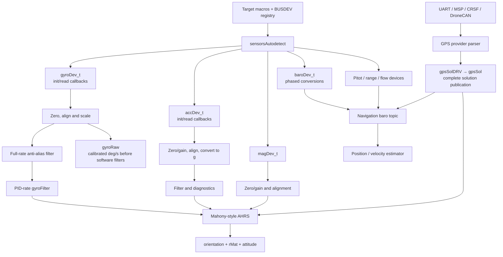
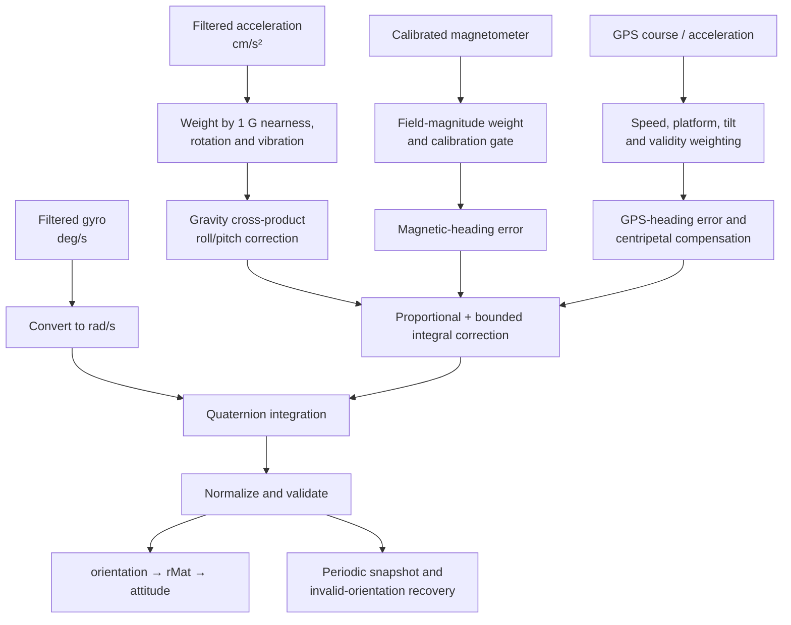

# 04 · Sensors & Attitude Estimation

How chip-specific samples become calibrated physical quantities, how health and validity are tracked, and how INAV estimates attitude from gyro, accelerometer, compass, and GPS evidence.

**[← Back to index](../README.md)** · Previous: [03 · Boot, Scheduler & Main Loop](03-boot-and-scheduler.md) · Next: [05 · Flight-Control Pipeline](05-flight-control.md)

---

## The model in one sentence

INAV uses **sensor frontends with bindable device drivers**: detection fills device callbacks, scheduled frontends calibrate/align/filter samples into shared units, and a Mahony-style AHRS combines rotation and reference vectors into a quaternion, rotation matrix, and Euler attitude.

Position and velocity estimation are a separate navigation stage covered in [Navigation & Missions](06-navigation-and-missions.md).

## Sensor architecture



## Detection and initialization

`sensorsAutodetect()` attempts the gyro first, then conditionally initializes enabled accelerometer, barometer, pitot, compass, temperature, rangefinder, and optical-flow classes ([`initialisation.c:47-79`](https://github.com/iNavFlight/inav/blob/7c2ac359401a839d0d70b9514630919f94314ff9/src/main/sensors/initialisation.c#L47-L79)).

Three related state representations answer different questions:

| State | Meaning |
|---|---|
| `requestedSensors[]` | Configured or requested hardware |
| `detectedSensors[]` | Hardware actually identified during detection |
| `sensors(SENSOR_...)` bitmask | Runtime enabled/present sensor state used by tasks and consumers |

For accelerometer, barometer, compass, and pitot, an autodetect selection can be replaced by the detected hardware and persisted. This is configuration discovery, not proof that later samples are healthy.

### Device callbacks

Typical device structures contain a `busDevice_t *`, init/read/update callbacks, raw axes, scale factors, calibration values, and alignment. Barometer and pitot interfaces add phased conversion operations and delays; rangefinder adds measurement status sentinels and detection-cone metadata.

The frontend owns common policy. The concrete driver owns bus transactions and chip-specific conversion.

## Update timing

| Path | Scheduler entry and timing | Work performed |
|---|---|---|
| Gyro acquisition | GYRO realtime task, rescheduled to driver-reported target interval | Read, zero, align, scale, first anti-alias filter |
| Main gyro filters, accel, AHRS | PID realtime task | Remaining gyro filters, `accUpdate()`, `imuUpdateAttitude()` |
| GPS | Nominal 50 Hz task | Provider state machines, parsing, timeout, solution publication |
| Compass | Nominal 10 Hz; any build defining `USE_MAG_MPU9250` reschedules an enabled compass task to 40 Hz | Read, calibration and alignment |
| Barometer | Initially 20 Hz | Phased conversion; driver delays reschedule task |
| Pitot | 20 ms | Protothread conversion, calibration, filtering and plausibility |
| Rangefinder | Initially 70 ms | Device-specific reschedule, filtering and tilt correction |
| Optical flow | 100 Hz | Flow validation and navigation topic |
| Battery | 50 Hz | Current, voltage, power, consumption and limit state |
| ESC sensor | Realtime callbacks, not an ordinary sensor task | Serial telemetry polling and age tracking |

Nominal scheduler periods are not guaranteed sample rates. Sensor algorithms should use actual delta time or driver-provided conversion timing where appropriate.

## Gyroscope pipeline

### Detection and instances

`gyroDetect()` conditionally tries enabled MPU, BMI, ICM, LSM, and fake families. On success, `gyroInit()` records detected type, sets sensor state, stores the driver-reported sample interval, and initializes filters.

On dual-IMU builds, `gyroDev[0]` is the flying gyro after selection. A second device can be exposed as `gyroRaw2`, but that second vector is for logging; it is not fused into attitude or PID estimation in this implementation.

**API pitfall:** failure to find a gyro can leave `gyro.initialized == false` while `gyroInit()` still returns true. Callers must inspect initialized/detected state, not only the Boolean return ([`gyro.c:335-408`](https://github.com/iNavFlight/inav/blob/7c2ac359401a839d0d70b9514630919f94314ff9/src/main/sensors/gyro.c#L335-L408)).

### Zero calibration

Startup gyro calibration operates on unaligned raw ADC counts and estimates a time-window mean plus standard deviation. Excessive motion can restart the window. The normal gyro calibration window is 2000 ms.

Until primary calibration completes, the published vector is forced to zero. If startup calibration is disabled, configured raw zero values are loaded instead.

The calibration helpers are shared with other sensors in [`common/calibration.c:112-199`](https://github.com/iNavFlight/inav/blob/7c2ac359401a839d0d70b9514630919f94314ff9/src/main/common/calibration.c#L112-L199).

### Sample transformations

For a successful read:

1. Subtract raw per-axis `gyroZero`.
2. Apply chip orientation.
3. Apply board and, where configured, tailsitter alignment.
4. Multiply by the device scale to obtain degrees per second.
5. Save the calibrated, aligned, unfiltered-by-software vector in `gyro.gyroRaw`.
6. Apply the full-sample-rate anti-alias filter into `gyro.gyroADCf`.

`gyroRaw` is therefore **not raw ADC counts**. It is already calibrated and in deg/s.

At PID rate, `gyroFilter()` applies configured stages in this order ([`gyro.c:578-650`](https://github.com/iNavFlight/inav/blob/7c2ac359401a839d0d70b9514630919f94314ff9/src/main/sensors/gyro.c#L578-L650)):

```text
ESC-RPM harmonic notches
 → LULU filter
 → main PT1 low-pass
 → adaptive-filter sample push
 → primary dynamic notch
 → secondary dynamic notch
 → optional Kalman filter
```

RPM/notch coefficient calculation can run in lower-rate tasks; the actual sample filtering runs in the GYRO/PID paths.

`gyroGetMeasuredRotationRate()` converts the filtered deg/s vector to rad/s for the AHRS. Other consumers can request deg/s instead.

### Read failure

A failed or unavailable driver read returns without replacing the current filtered vector. There is no universal freshness timeout in this layer. Consumers must not interpret a changing task counter as proof of a new sample.

## Accelerometer pipeline

Accelerometer detection supports explicit disable, explicit hardware, and autodetection. On dual-IMU builds it deliberately selects the same IMU tag as the flying gyro.

For combined MPU devices, the gyro's bus transaction can store accel, temperature, and gyro data in the bus scratchpad. `accUpdate()` then consumes the cached accel sample at PID rate rather than issuing another transaction.

### Six-position calibration

Calibration collects stable averages with the craft placed on each principal face:

- determines the dominant axis after chip alignment;
- rejects ambiguous orientation;
- collects a 500 ms stable window per position;
- solves three-axis offsets and scale factors;
- stores gains in Q12 form, where 4096 means unity.

Normal updates apply zero and gain before chip/board alignment because the calibration was solved in the sensor's raw coordinate system. See [`acceleration.c:334-525`](https://github.com/iNavFlight/inav/blob/7c2ac359401a839d0d70b9514630919f94314ff9/src/main/sensors/acceleration.c#L334-L525).

### Runtime processing

`accUpdate()` performs:

```text
read or reuse sample
 → calibration zero/gain
 → chip and board alignment
 → divide by acc_1G to obtain g
 → clipping and vibration measurements
 → PT1 or biquad low-pass
 → optional notch
```

`acc.accADCf` is in g. `accGetMeasuredAcceleration()` multiplies by `GRAVITY_CMSS`, supplying **cm/s²** to the IMU ([`acceleration.c:538-544`](https://github.com/iNavFlight/inav/blob/7c2ac359401a839d0d70b9514630919f94314ff9/src/main/sensors/acceleration.c#L538-L544)). A nearby stale comment mentioning m/s² should not override the implementation and interface contract.

Diagnostics are calculated before the main low-pass/notch so vibration and clipping are not hidden by the output filter.

## Attitude estimation (AHRS)

AHRS means Attitude and Heading Reference System: logic that estimates vehicle orientation. INAV's `flight/imu.c` uses a quaternion and a Mahony-style complementary correction, not the navigation position estimator and not a full inertial navigation EKF.

### Public state and units

| Value | Unit/frame | Meaning |
|---|---|---|
| `imuMeasuredRotationBF` | rad/s, body frame | Filtered gyro input to integration |
| `imuMeasuredAccelBF` | cm/s², body frame | Measured specific force/acceleration input |
| `orientation` | Quaternion | Current body/earth orientation |
| `rMat` | Rotation matrix | Cached transform derived from orientation |
| `attitude` | Decidegrees | Roll, pitch, yaw for control and display |
| `HeadVecEFFiltered` | Filtered earth-frame vector | Heading-related consumers and weighting |

Euler sign conventions are roll right positive, **pitch down positive**, and yaw right positive. Yaw is wrapped into the 0–3599 decidegree representation.

### Per-PID-cycle flow



`imuUpdateAttitude()` calls the estimator only if an accelerometer exists and has produced an update. Otherwise acceleration is zeroed and the normal estimator update is skipped ([`imu.c:935-952`](https://github.com/iNavFlight/inav/blob/7c2ac359401a839d0d70b9514630919f94314ff9/src/main/flight/imu.c#L935-L952)). `isImuReady()` additionally requires completed accel and gyro calibration.

### Correction sources

| Source | Corrects | Important gating |
|---|---|---|
| Accelerometer gravity | Roll and pitch | Weight decreases away from 1 G and at high rotation; GPS/turn models can compensate centripetal acceleration |
| Magnetometer | Heading/yaw | Requires healthy field, excludes calibration samples, and weights field magnitude around the normalized reference |
| GPS course over ground | Heading/yaw | Requires appropriate fix, speed, and platform conditions |
| GPS acceleration / airspeed turn model | Centripetal compensation | Used to avoid interpreting coordinated-turn acceleration as pure gravity |

The core update is [`imuMahonyAHRSupdate()` in `imu.c:372-613`](https://github.com/iNavFlight/inav/blob/7c2ac359401a839d0d70b9514630919f94314ff9/src/main/flight/imu.c#L372-L613).

### Convergence and numerical recovery

- During the initial disarmed convergence window, proportional gains are increased to acquire attitude quickly.
- Integral correction is limited at high rotation and clamped against windup.
- Quaternion integration uses a small-angle approximation or full axis-angle form and normalizes the result.
- A previous orientation is snapshotted periodically. Invalid/NaN orientation can trigger restoration or a best-guess reconstruction with diagnostics.

These are safety mechanisms, not permission to ignore filter, calibration, or timing faults.

## Coordinate frames

A coordinate frame defines which physical directions X, Y, and Z represent. INAV converts between several conventions at explicit boundaries.

| Interface | Convention |
|---|---|
| Body-frame gyro/accel | Vehicle axes after chip and board alignment |
| Raw AHRS `rMat` earth frame | Documented as North, West, Up |
| `imuTransformVectorBodyToEarth()` | Applies rotation and Y sign change for navigation-facing NEU |
| Navigation local position | NEU: X north, Y east, Z up |
| GPS `velNED` | NED: north, east, down |
| Navigation yaw | Often centidegrees |
| IMU attitude | Decidegrees; pitch down positive |

The transforms in [`imu.c:229-245`](https://github.com/iNavFlight/inav/blob/7c2ac359401a839d0d70b9514630919f94314ff9/src/main/flight/imu.c#L229-L245) are not convention-neutral quaternion helpers. Do not remove their sign changes or feed GPS NED velocity directly into NEU without conversion.

## Compass

The compass frontend stores calibrated and aligned `magADC` plus a calibrated pre-alignment snapshot for configuration/alignment UI.

Normal processing is:

```text
read → calibration zero/gain → save unaligned snapshot → align
```

Onboard and external compasses have different alignment paths. External alignment uses its configured rotation and tailsitter handling but does not follow the exact onboard `applyBoardAlignment()` sequence. Preserve that distinction when changing alignment code.

Calibration temporarily removes stored offsets/gains while the vehicle rotates, solves hard-iron offset and per-axis gain, and AHRS fusion excludes samples during that operation.

The values are normalized driver-independent counts, not tesla. Health is currently simple—at least one calibrated axis nonzero—and a failed read zeroes the vector.

## Barometer

`baroUpdate()` is a two-phase temperature/pressure conversion state machine. Each phase returns a delay that the scheduler uses for the next invocation. This avoids assuming every sensor has the same conversion time.

| Value | Unit |
|---|---|
| Pressure | Pa |
| Internal temperature | Centidegrees Celsius; getter exposes decidegrees |
| Altitude | cm relative to calibrated ground pressure |

Startup calibration accumulates ground pressure for approximately two seconds. Before successful calibration, altitude is forced to zero. Afterwards, pressure altitude is referenced to ground and can receive temperature compensation.

`baroIsHealthy()` checks presence, not conversion freshness or pressure plausibility. The baro task separately publishes the processed altitude into the navigation estimator.

## Rangefinder and optical flow

Rangefinder drivers return distance or negative status sentinels for out-of-range, hardware failure, and no-new-data. The frontend:

- tracks communication freshness;
- optionally applies a median filter;
- rejects excessive tilt or invalid measurements;
- computes vertical altitude as `rawDistance × cos(tilt)`.

Raw and calculated distance are in cm. Health means recent communication, not necessarily an in-range surface.

Optical-flow processing has its own freshness and quality hysteresis. Navigation uses flow only when surface, Z, and reliability preconditions are satisfied. See [Position estimation](06-navigation-and-missions.md#sensor-topics).

## Pitot and airspeed

Pitot drivers measure differential pressure. The frontend runs a protothread for conversion timing, performs zero-pressure calibration, filters pressure, and computes indicated airspeed:

```text
IAS = scale × sqrt(2 × |pressure - pressureZero| / density)
```

The public airspeed representation is cm/s.

Three states must not be conflated:

1. **Healthy:** a successful driver operation within the freshness window.
2. **Plausible:** armed-flight airspeed agrees sufficiently with GPS/wind-derived virtual airspeed.
3. **Valid estimate:** the combined result of health, calibration, configured virtual-sensor policy, plausibility failure, and possible GPS fallback.

Sustained implausibility can fail the hardware airspeed source and permit a virtual fallback; recovery requires a longer plausible sequence.

## GPS frontend

GPS code lives in `io/`, but it is a central sensor normalization boundary.

### Provider model

Providers such as UBlox, MSP, CRSF, fake, and DroneCAN fill `gpsSolDRV`. Only a complete update is copied to public `gpsSol`, preventing consumers from observing a partially updated solution.

`gpsSolutionData_t` normalizes:

- fix type and satellite count;
- latitude/longitude in degrees × 10⁷;
- altitude in cm;
- NED velocity and ground speed in cm/s;
- ground course in decidegrees;
- EPH/EPV accuracy and validity flags;
- heartbeat/new-data metadata.

See [`gps.h:113-159`](https://github.com/iNavFlight/inav/blob/7c2ac359401a839d0d70b9514630919f94314ff9/src/main/io/gps.h#L113-L159).

Publication sets communication and fix state, validates velocity/accuracy fields, notifies navigation/IMU consumers, and toggles heartbeat ([`gps.c:381-428`](https://github.com/iNavFlight/inav/blob/7c2ac359401a839d0d70b9514630919f94314ff9/src/main/io/gps.c#L381-L428)).

**`SENSOR_GPS` means communicating hardware; `GPS_FIX` means usable fix.** Neither alone proves that every field is valid or fresh.

## Battery and ESC sensing

Battery frontends can select ADC, ESC telemetry, protocol sensors, DroneCAN, INA226, fake, or virtual sources. Common units are:

| Quantity | Unit |
|---|---|
| Voltage | 0.01 V |
| Current | 0.01 A |
| Power | 0.01 W |
| Capacity | mAh or mWh |
| Supply impedance | mΩ |

The battery task updates current, voltage, power, consumption, sag compensation, cell/profile state, and warnings as configured. Filtering and freshness are source-specific rather than uniform.

ESC telemetry adds temperature, voltage, current, mechanical RPM, and age. A combined snapshot can expose maximum temperature/age and mean voltage/RPM. RPM also drives harmonic gyro-notch coefficients.

Freshness rules belong to each source. Do not infer that all battery or ESC values expire after the same timeout.

## Health and diagnostics

Diagnostics report already-known state; they do not perform a new hardware transaction on every query.

| Sensor | Current health meaning |
|---|---|
| Gyro | Detection/initialization state; not a general per-sample freshness check |
| Accelerometer | Detection plus `accIsHealthy()`, which currently always returns true |
| Compass | Nonzero calibrated vector after read behavior |
| Barometer | Sensor presence |
| GPS | Presence/provider state; repeated timeouts affect availability, while `isGPSHealthy()` itself is constant true here |
| Rangefinder | Recent valid communication |
| Pitot | Recent successful operation; separate from plausibility failure |
| Optical flow | Fresh valid update and quality hysteresis |

`isHardwareHealthy()` feeds arming policy, while calibration has separate arming blockers. A healthy result is therefore not a universal statement about data quality.

## Sensor-system invariants

1. **Detection, calibration, communication, health, and measurement validity are separate states.**
2. **`gyroRaw` is calibrated/aligned deg/s, not ADC counts.** `gyroRaw2` is logging-only.
3. **Failed-read behavior is not uniform.** Gyro/accel can retain previous values; compass zeroes its vector.
4. **The AHRS requires an accelerometer update before its normal estimator runs.** Gyro alone does not take that path.
5. **Acceleration supplied to the IMU is cm/s².** Gyro supplied to the IMU is rad/s.
6. **Use the documented frame conversion at each boundary.** NEU, NED, and raw AHRS NWU are not interchangeable.
7. **Magnetometer calibration samples are excluded from yaw fusion.** Do not bypass that guard.
8. **External and onboard compass alignment are different paths.** Test the intended mounting type.
9. **Driver delays can control scheduler cadence.** Baro/rangefinder timing is not fixed by the initial table alone.
10. **Static device state is not automatically reentrant.** Audit before adding instances.
11. **Health functions can be intentionally shallow.** Arming safety also depends on calibration, navigation validity, timeout, and platform-specific checks.
12. **Filter settings have rate dependencies.** Anti-alias filters use gyro sample timing; later filters use PID timing.

## Navigation

**[← Back to index](../README.md)** · Previous: [03 · Boot, Scheduler & Main Loop](03-boot-and-scheduler.md) · Next: [05 · Flight-Control Pipeline](05-flight-control.md)
