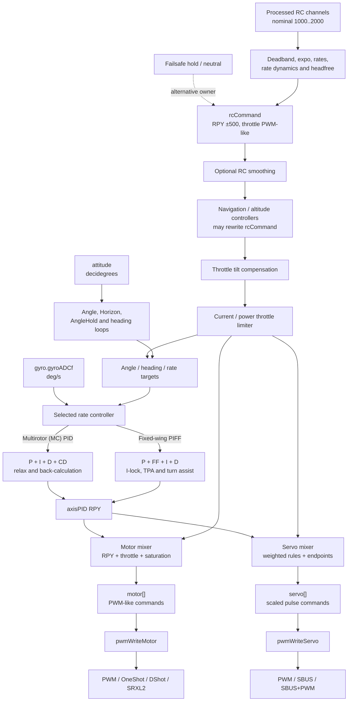
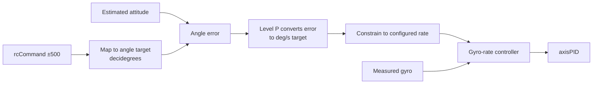
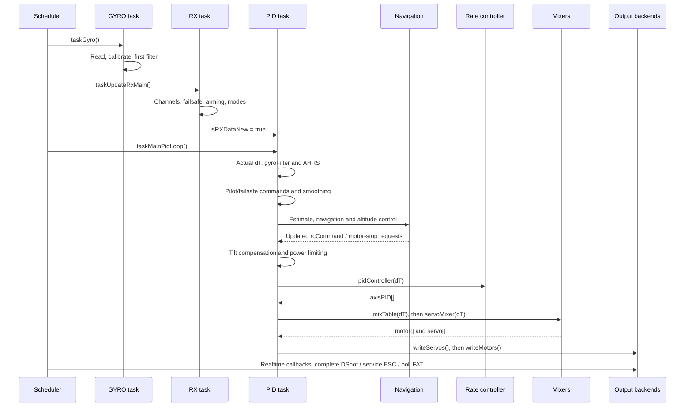

# 05 · Flight-Control Pipeline

How receiver or navigation demands become rate targets, controller corrections, mixed motor/servo commands, and protocol-specific actuator output.

**[← Back to index](../README.md)** · Previous: [04 · Sensors & Attitude Estimation](04-sensors-and-estimation.md) · Next: [06 · Navigation & Missions](06-navigation-and-missions.md)

---

## The model in one sentence

The PID task transforms shared `rcCommand[]` and estimated attitude into gyro-rate targets, applies a multirotor PID or fixed-wing PIFF controller, mixes the resulting normalized corrections with throttle, and writes motor/servo commands through initialized output backends.

This is a **shared-state pipeline**, not a message-passing control framework.

## End-to-end data flow



The controlling sequence is [`taskMainPidLoop()` in `fc_core.c:988-1097`](https://github.com/iNavFlight/inav/blob/7c2ac359401a839d0d70b9514630919f94314ff9/src/main/fc/fc_core.c#L988-L1097).

## Shared control values and units

| Value | Representation | Owner / producer |
|---|---|---|
| `rxGetChannelValue()` | Nominal 1000–2000 processed RC domain | RX frontend |
| `rcCommand[ROLL/PITCH/YAW]` | Normally −500…+500 | Pilot/failsafe/navigation processing |
| `rcCommand[THROTTLE]` | PWM-like throttle domain | Pilot/failsafe/navigation, then compensation/limiting |
| `gyro.gyroADCf[]` | Filtered deg/s, body frame | Gyro frontend |
| `imuMeasuredRotationBF` | rad/s, body frame | AHRS input conversion |
| `attitude` | Decidegrees | AHRS |
| Rate target | Degrees/second | PID target generation |
| `axisPID[]` | Normalized correction; R/P normally ±500, MC yaw ±400 | Selected rate controller |
| `motor[]` | PWM-like output command before protocol conversion | Motor mixer |
| `servo[]` after scaling | Pulse-domain command constrained by configured endpoints | Servo mixer |

Axis indices deliberately align: `FD_ROLL`, `FD_PITCH`, and `FD_YAW` match X/Y/Z indices used by three-axis arrays.

## RX-task versus PID-task responsibilities

The RX task processes receiver data, failsafe state, stick/switch positions, arming, and flight-mode flags. It then sets `isRXDataNew`.

The PID task:

- transforms accepted RC channels into `rcCommand`;
- applies failsafe control when active;
- updates navigation mode when the RX-handoff flag is set;
- performs interpolation, estimation, control, mixing, and output.

This split means mode policy and control-target generation are related but not atomic. The Boolean handoff can coalesce several RX invocations.

## Pilot command transformation

### Roll, pitch, and yaw

`getAxisRcCommand()` subtracts 1500, constrains to ±500, applies a rescaled deadband, and applies the RC expo lookup ([`fc_core.c:187-206`](https://github.com/iNavFlight/inav/blob/7c2ac359401a839d0d70b9514630919f94314ff9/src/main/fc/fc_core.c#L187-L206)).

Roll/pitch/yaw are recomputed when RX processing has run and cached between updates. Yaw is negated at this boundary. Then:

- MANUAL applies configured manual rates;
- stabilized modes apply rate dynamics and relevant VTOL protection shaping;
- headfree can rotate roll/pitch commands relative to a captured heading.

The rate conversion later maps ±500 linearly to ±`rate × 10` degrees/second.

### Throttle

Throttle processing remaps the accepted channel to 0–1000, applies the configured throttle curve, and produces a value between the computed idle region and maximum throttle. Reversible-motor mode changes the lower endpoint and neutral handling.

### Smoothing

Optional RC interpolation samples new unfiltered commands on RX updates and smooths all four commands at PID-loop rate. It acts after pilot/failsafe command generation and before navigation.

### Failsafe and programming overrides

When failsafe owns control, it can hold last-good commands or neutralize axes according to the configured procedure. Navigation then uses the same command interface.

Programming-framework helpers can override RC channels, `rcCommand`, angle targets, or rate targets at defined query points. These are not one unified arbitration protocol; each override's position in the pipeline determines precedence.

## Setpoint arbitration by call order

```text
pilot or failsafe
 → optional RC smoothing
 → navigation and altitude controllers
 → multirotor throttle tilt compensation
 → optional current/power throttle limiting
 → PID angle/rate overrides and controllers
 → motor and servo mixers
```

**Maintainer invariant:** moving these calls changes control ownership, filtering behavior, and safety behavior. Review every `rcCommand` writer before reordering.

## PID controller architecture

`pidInit()` selects a function-pointer strategy:

| Type | Controller | Default use |
|---|---|---|
| `PID_TYPE_PID` | `pidApplyMulticopterRateController` | Multirotor and other non-fixed-wing platforms as selected |
| `PID_TYPE_PIFF` | `pidApplyFixedWingRateController` | Airplane, boat, and rover under automatic selection |
| `PID_TYPE_AUTO` | Chooses from platform flags | Normal automatic configuration |

`pidState_t` holds per-axis gains, measured/target rates, integrators and limits, filters, previous rates, anti-windup state, and fixed-wing attenuation. Public `axisPID[3]` is the mixer-facing result. See [`pid.h:188-239`](https://github.com/iNavFlight/inav/blob/7c2ac359401a839d0d70b9514630919f94314ff9/src/main/flight/pid.h#L188-L239).

PID gains are not necessarily recomputed every control iteration. The 100 Hz AUX task calls `updatePIDCoefficients()` when scheduled or when TPA changes require it.

### Main `pidController()` sequence

1. Copy filtered gyro rates into per-axis state.
2. Generate base rate targets from `rcCommand` or heading hold.
3. Clamp targets to gyro saturation limits.
4. On roll/pitch, run angle/level control when ANGLE, HORIZON, ANGLEHOLD, or an angle override is active.
5. Apply coordinated-turn assistance or multirotor FPV camera mixing where configured.
6. Compute anti-windup scaling from mixer saturation.
7. Apply setpoint acceleration limits.
8. Invoke the selected multirotor or fixed-wing rate controller.

The implementation is in [`pid.c:2072-2187`](https://github.com/iNavFlight/inav/blob/7c2ac359401a839d0d70b9514630919f94314ff9/src/main/flight/pid.c#L2072-L2187).

## Angle-to-rate cascade

A cascaded controller uses an outer loop to produce the target for an inner loop. In ANGLE-like modes:



- `pidRcCommandToAngle()` maps full stick to the configured maximum inclination.
- `pidLevel()` compares against estimated attitude and produces a rate target.
- HORIZON blends angle-derived and acro/rate-derived targets according to stick deflection.
- Optional Level I is used as a filter-cutoff mechanism in this path, not as a conventional additional integrator.

ANGLEHOLD captures absolute roll/pitch targets and adjusts them with stick input; centered sticks hold the captured attitude. Fixed-wing level trim can modify the pitch target.

## Heading hold

Heading hold is an outer P controller producing yaw rate:

- target and error are in degrees, converted from attitude decidegrees;
- error wraps to ±180°;
- output is limited by the configured heading-hold rate and filtered;
- manual yaw overrides update the target;
- excessive tilt can disable it.

Navigation heading controllers can update the same target. Unit conversion here is essential: `attitude.values.yaw` is decidegrees, while this controller's internal heading error uses degrees.

## Multirotor rate PID

The multirotor path combines:

```text
output = P + I + D + CD
```

| Term | Input and purpose |
|---|---|
| P | Rate-target minus measured gyro error |
| I | Accumulated error with relax and anti-windup |
| D | Derivative of measured gyro, with configurable filtering |
| CD | Separately filtered derivative of the rate target (“control derivative”) |

Back-calculation uses the difference between unlimited and limited output to adjust integration. Mixer saturation therefore affects the integrator instead of allowing unlimited windup.

Multirotor TPA (throttle PID attenuation) scales gains with throttle and can optionally exclude yaw.

## Fixed-wing PIFF

PIFF here denotes a controller with proportional, integral, and feedforward contributions, with D also present in the implementation:

```text
axisPID = P + FF + I + D
```

FF is proportional to the rate target, providing immediate command response without waiting for error.

Important fixed-wing mechanisms include:

- **I-term lock:** attenuates terms during large demands and can suppress integration to reduce bounceback;
- **yaw-I freeze:** optional at high bank, except relevant autotune/turn-assist cases;
- **TPA:** throttle- or airspeed-based gain attenuation;
- **coordinated turn:** derives earth-frame turn rate from bank and airspeed, transforms it to body frame, and adds rate targets;
- **servo autotrim:** can adjust configured servo midpoints from stable integrator behavior and reduce the corresponding PID integrator.

Both controller families derive D primarily from measured gyro rather than simple setpoint-error derivative.

## Multirotor versus fixed-wing paths

| Concern | Multirotor / tricopter / helicopter | Fixed-wing airplane |
|---|---|---|
| Default controller | PID with P+I+D+CD | PIFF with P+FF+I+D |
| Main actuators | Motor thrust mixing; servos can also exist | Control-surface servos plus throttle/differential thrust |
| Angle control | ANGLE/HORIZON cascade | Shared cascade plus airplane trim and launch/landing behavior |
| Yaw | Optional heading hold and FPV mix | Heading hold plus coordinated-turn assistance |
| TPA | Throttle-based | Throttle- or airspeed-based |
| Anti-windup | Relax, back-calculation, mixer saturation | I-lock, bank-based yaw-I freeze, global limiting |
| MANUAL | Not the fixed-wing passthrough mode | Transformed `rcCommand` bypasses `axisPID` as stabilized mixer input |
| Navigation | Acceleration-to-tilt and vertical-throttle cascades | Track/bank guidance plus pitch/throttle/speed control |

Platform selection does not determine actuator count by itself. Motor and servo mixers can both run for a configuration, including VTOL/profile-transition setups.

## Motor mixer

`mixer.c` owns `motor[]`, disarmed motor values, throttle command, active mixer coefficients, motor count, and saturation state. Each `motorMixer_t` supplies throttle, roll, pitch, and yaw coefficients.

### Disarmed and motor-stop early return

Except for turtle-mode handling, `mixTable()` first checks disarmed or motor-stop state. It then writes safe stopped/disarmed values and returns before normal RPY/throttle mixing ([`mixer.c:658-680`](https://github.com/iNavFlight/inav/blob/7c2ac359401a839d0d70b9514630919f94314ff9/src/main/flight/mixer.c#L658-L680)).

**Armed is not the same as motors running.** Navigation stop/idle requests, low-throttle policy, airmode, and failsafe can stop or idle motors while armed.

### Stabilized versus MANUAL input

Normally motor RPY corrections come from `axisPID`. For `FIXED_WING_LEGACY && MANUAL_MODE`, they come from transformed `rcCommand` instead. This is not raw receiver data: mapping, deadband, expo, manual rates, smoothing, and earlier overrides may already have acted.

MANUAL does not skip `pidController()`; it changes which values the mixers select.

### Mixing and saturation

Conceptually, each motor correction is:

```text
rpyMix[i] =
    (pitchInput × mixer[i].pitch
   + rollInput  × mixer[i].roll
   - yawMultiplier × yawInput × mixer[i].yaw)
   × mixerScale
```

The mixer calculates the correction span relative to available throttle range. If authority exceeds the range, it scales corrections and narrows/adjusts throttle headroom to limit clipping. Final output is:

```text
motor[i] = rpyMix[i] + constrained(throttle × mixer[i].throttle)
```

with protocol-independent final constraints. Throttle processing can include reversible-motor handling, configured scaling, battery-voltage compensation, and fixed-wing rate limiting.

Fixed-wing emergency landing can suppress motor RPY corrections so differential thrust cannot defeat the emergency throttle policy.

### Anti-windup feedback is one mixer pass old

The PID task calls `pidController()` before `mixTable()`. PID reads the saturation state from the preceding mixer pass, not from outputs that have not yet been computed. This is intentional feedback ordering; do not describe it as same-pass saturation.

## Servo mixer

### Rule model

Each `servoMixer_t` rule specifies:

- target servo;
- input source;
- rate/weight;
- optional speed limit;
- optional activation condition.

Input sources include stabilized R/P/Y/throttle, raw centered RC channels, gimbal/flap/feature inputs, programming variables, transitions, and sign-split sources.

For stabilized sources, MANUAL uses transformed `rcCommand`; assisted modes use `axisPID`. Raw `INPUT_RC_*` sources are a separate path and should not be confused with MANUAL stabilized input.

### Accumulation and scaling

Rules accumulate into a normalized target array:

```text
limitedInput = rateLimit(input, speed, dT)
servo[target] += limitedInput × rule.rate / 100
```

The array is then converted into pulse-domain commands:

```text
pulse = constrain(
    middle + normalizedSum × servoRate/100 × scaleForSign,
    min,
    max
)
```

Positive and negative sides use their own `(max-middle)` or `(middle-min)` scale. Optional output filtering and final constraint occur in `writeServos()`.

**Representation pitfall:** `servo[]` changes from a normalized accumulator to a pulse-domain value within `servoMixer()`. Code inserted midway must know which representation it is reading.

### Configuration invariants

- Motor discovery expects throttle-bearing motor entries to be contiguous.
- Servo rule loading stops at the first zero-rate rule; active custom rules must be contiguous.
- Output allocation scans all mixer profiles so a later hot switch cannot require unallocated outputs.
- Profile switches reselect controller strategy and reset/reinitialize relevant controller and filter state.

## Current and power limiting

Power limiting has two timescales:

1. The 50 Hz battery task updates filtered measurements and burst/continuous active-limit state.
2. The PID task applies throttle attenuation after navigation and tilt compensation but before PID/mixing.

The limiter computes over-current and over-power conditions, applies filtered PI attenuation, and selects the more restrictive throttle result. It only attenuates throttle; it does not directly generate attitude corrections or motor outputs.

Because it mutates `rcCommand[THROTTLE]`, downstream mixer and throttle-dependent control behavior see the limited command.

## Output APIs and protocols

The hardware-facing API is small:

```c
void pwmWriteMotor(uint8_t index, uint16_t value);
void pwmWriteServo(uint8_t index, uint16_t value);
void pwmCompleteMotorUpdate(void);
```

See [`pwm_output.h:39-61`](https://github.com/iNavFlight/inav/blob/7c2ac359401a839d0d70b9514630919f94314ff9/src/main/drivers/pwm_output.h#L39-L61).

| Stage | Convention |
|---|---|
| Mixer `motor[]` | PWM-like command domain |
| Analog motor output | Microsecond-style timer value |
| DShot | Converted at output: 0 disarm, 48–2047 throttle range |
| Servo after scaling | Pulse-domain value constrained by min/middle/max |
| SRXL2 / servo SBUS | Values staged for a serial protocol state machine |

### Digital and serial completion

`writeMotors()` stages output. DShot rate gating, packet formation, and DMA completion occur later through `pwmCompleteMotorUpdate()` in realtime callbacks. Servo SBUS frames and SRXL2 protocol state machines are serviced by the 200 Hz PWM-driver task.

The output protocol is latched during initialization. Changing a configuration field alone does not safely switch function pointers, timers, DMA, or serial resources.

## Arming and safe-output behavior

`armingFlags`, `flightModeFlags`, and `stateFlags` are separate global bitfields. Arming checks include calibration, RX, throttle, attitude, scheduler load, navigation safety, sensor health, output health, failsafe, and related policy.

Key distinctions:

| State | What it does and does not mean |
|---|---|
| Disarmed | Mixer emits safe disarmed motor commands; scheduler and PID still run; servos can still move |
| Armed | Normal control policy is allowed; motor-stop can still keep motors stopped/idle |
| `motorControlEnable` | Late-init output gate; independent of `ARMED` |
| Servo output enabled | Separate gate used by CMS/output policy |
| Failsafe active | Can replace pilot commands, force navigation procedures, and eventually disarm/block rearm |

Emergency arming overrides only explicitly permitted blockers, not every safety condition. The failsafe rearm lockout is specifically protected from programming-framework override.

## Control-cycle sequence



The tasks are shown in a representative order for data dependencies, not as a guaranteed scheduler order on every outer-loop pass.

## Control-path invariants and pitfalls

1. **Call order is the arbitration mechanism.** There is no universal immutable setpoint object.
2. **Units differ across adjacent stages.** Decidegrees, degrees, dps, rad/s, normalized corrections, and PWM-like values all appear.
3. **Positive pitch is down.** Fixed-wing navigation explicitly converts its internal climb-positive pitch demand.
4. **MANUAL bypasses stabilization selection, not PID execution.** PID still runs; mixers select transformed commands instead.
5. **Disarmed is not “all outputs disabled.”** Servo output generally continues unless separately disabled.
6. **Motor-stop and disarmed are different states.** Their output values and policy differ.
7. **`FIXED_WING_LEGACY` includes rover and boat.** Use `AIRPLANE` for airplane-only logic.
8. **Mixer saturation feedback is from the previous pass.** Preserve or deliberately redesign the ordering.
9. **Motor/servo rules rely on contiguity.** Empty entries can terminate discovery.
10. **Output protocol changes require reinitialization.** Do not hot-swap latched backends through config alone.
11. **`servo[]` has two representations during mixing.** Know whether it is normalized or pulse-domain.
12. **Time-dependent filters and differentiators need valid `dT`.** The PID task uses actual scheduler delta for this reason.

## Navigation

**[← Back to index](../README.md)** · Previous: [04 · Sensors & Attitude Estimation](04-sensors-and-estimation.md) · Next: [06 · Navigation & Missions](06-navigation-and-missions.md)
