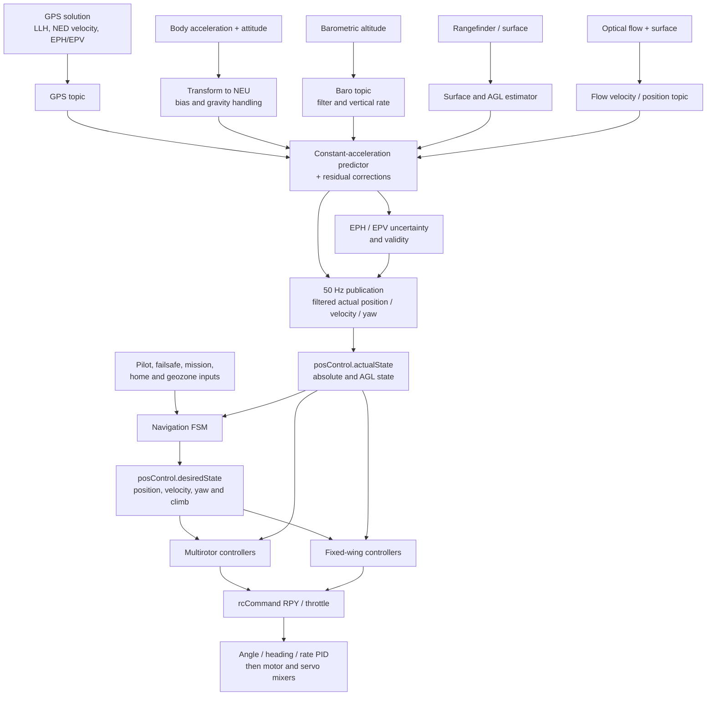
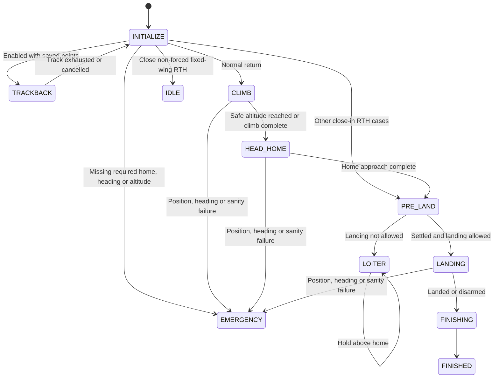
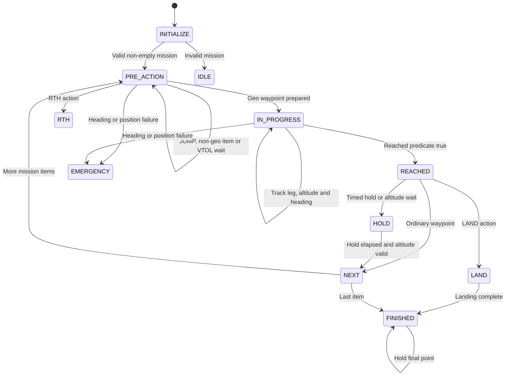

# 06 · Navigation & Missions

How INAV fuses local position and velocity, selects navigation modes, controls multirotor and fixed-wing flight, and executes RTH, waypoint missions, launch, landing, and geozone behavior.

**[← Back to index](../README.md)** · Previous: [05 · Flight-Control Pipeline](05-flight-control.md) · Next: [07 · RC, Serial & Communications](07-communications.md)

---

## The model in one sentence

Sensor-specific producers fill a constant-acceleration position estimator; the estimator publishes actual state into a table-driven navigation finite-state machine (FSM), whose platform controllers write the same `rcCommand[]` attitude/throttle demands used by pilot input.

Navigation is not a separate autopilot output stack. It feeds the ordinary PID and mixer pipeline described in [Flight-Control Pipeline](05-flight-control.md).

## End-to-end navigation flow



## Two central state stores

| Store | Purpose | Important contents |
|---|---|---|
| `navigationPosEstimator_t posEstimator` | Sensor topics and fusion working state | Topic samples/times, predicted estimate, EPH/EPV, AGL, acceleration bias |
| `navigationPosControl_t posControl` | Navigation policy and published state | FSM, actual/desired state, controllers, GPS origin, home/RTH, missions, safehome and statistics |

`posControl` is externally visible to navigation-related modules. These are logical ownership boundaries, not encapsulated thread-safe objects. The main structure is in [`navigation_private.h:472-553`](https://github.com/iNavFlight/inav/blob/7c2ac359401a839d0d70b9514630919f94314ff9/src/main/navigation/navigation_private.h#L472-L553).

## Frames, units, and altitude meanings

| Quantity | Representation |
|---|---|
| GPS latitude/longitude | Degrees × 10⁷ |
| Local navigation frame | NEU: X north, Y east, Z up |
| Local position | cm, `fpVector3_t` |
| Velocity | cm/s |
| Acceleration | cm/s² |
| EPH / EPV | Estimated horizontal / vertical error, cm |
| `posControl.actualState.yaw` and desired yaw | Centidegrees |
| IMU `attitude` | Decidegrees; roll right, pitch down, yaw right positive |
| GPS ground course / estimator COG | Decidegrees |
| `rcCommand` RPY | Normally −500…+500 |
| Public home distance/bearing compatibility values | Metres/degrees, although internal values use cm/centidegrees |

### Local geodetic conversion

INAV uses a local equirectangular approximation around a GPS origin:

```text
north_cm = (lat - origin_lat) × 1.113195
east_cm  = (lon - origin_lon) × 1.113195 × cos(origin_latitude)
up_cm    = altitude - origin_altitude       # absolute datum
up_cm    = altitude                         # relative datum
```

See [`navigation_geo.c:108-168`](https://github.com/iNavFlight/inav/blob/7c2ac359401a839d0d70b9514630919f94314ff9/src/main/navigation/navigation_geo.c#L108-L168). This is suitable for local flight areas, not a global geodesic solution; distortion grows over large distances and near the poles.

GPS NED down velocity is negated for NEU Z. IMU transform helpers apply their own documented Y-sign conversion.

### Absolute versus AGL state

`actualState` contains:

- `abs`: position/velocity relative to the GPS/home origin;
- `agl`: surface-relative Z and vertical speed, sharing XY with `abs`.

When terrain following is enabled, public current-position getters can select AGL Z rather than absolute Z. A scalar Z getter is therefore context-dependent.

RTH, missions, emergency landing initialization, and relevant VTOL transitions explicitly manage or disable terrain following. Fixed-wing support for rangefinder-driven `SURFACE` terrain following is unsupported in this tree; the separate SD-map fixed-wing AGL-hold capability is described in [Terrain services](08-osd-logging-and-programming.md#terrain-services).

## Sensor topics

### GPS

On an accepted solution, `onNewGPSData()`:

1. Establishes a GPS origin on the first valid solution.
2. Manages origin-altitude reset/correction policy.
3. Converts LLH to local NEU.
4. Uses direct NED velocity when valid, otherwise coordinate differences.
5. Uses reported EPH/EPV or defaults.
6. Records update timing.

The GPS origin can exist before a navigation **home** is valid. Origin and home are separate concepts.

Common GPS intervals are quantized to reduce timing jitter; other intervals use measured delta time. See [`navigation_pos_estimator.c:175-294`](https://github.com/iNavFlight/inav/blob/7c2ac359401a839d0d70b9514630919f94314ff9/src/main/navigation/navigation_pos_estimator.c#L175-L294).

### IMU/AHRS

Before navigation estimation, the PID task updates gyro filtering, acceleration, and attitude. The estimator then:

- transforms body acceleration to NEU;
- applies learned acceleration bias;
- derives an acceleration-confidence factor from vibration/clipping;
- calibrates gravity while disarmed;
- subtracts calibrated gravity from NEU Z;
- publishes navigation acceleration for logging.

The confidence factor is path-specific: absolute XYZ prediction integrates `accelNEU` directly, AGL prediction attenuates acceleration by the factor, and GPS/baro/flow residual corrections are divided by it before clamping. Lower confidence therefore does not simply scale every acceleration-related term down ([`navigation_pos_estimator.c:537-562`](https://github.com/iNavFlight/inav/blob/7c2ac359401a839d0d70b9514630919f94314ff9/src/main/navigation/navigation_pos_estimator.c#L537-L562), [`navigation_pos_estimator.c:817-824`](https://github.com/iNavFlight/inav/blob/7c2ac359401a839d0d70b9514630919f94314ff9/src/main/navigation/navigation_pos_estimator.c#L817-L824), and [`navigation_pos_estimator_agl.c:140-143`](https://github.com/iNavFlight/inav/blob/7c2ac359401a839d0d70b9514630919f94314ff9/src/main/navigation/navigation_pos_estimator_agl.c#L140-L143)).

If the IMU is not ready, estimate validity is cleared rather than treating uncalibrated acceleration as trustworthy.

### Barometer

The baro task invokes the altitude topic handler after every `baroUpdate()` driver-phase call, not only after a completed pressure conversion. The topic handler recalculates from the currently stored pressure, applies reset/reference offset, configured vertical uncertainty, a low-pass filter, and differentiation into vertical rate. Its update timestamp therefore does not by itself prove that a new pressure sample was converted ([`fc_tasks.c:197-208`](https://github.com/iNavFlight/inav/blob/7c2ac359401a839d0d70b9514630919f94314ff9/src/main/fc/fc_tasks.c#L197-L208) and [`barometer.c:279-303`](https://github.com/iNavFlight/inav/blob/7c2ac359401a839d0d70b9514630919f94314ff9/src/main/sensors/barometer.c#L279-L303)). Reference reset behavior supports never, first arm, or every arm; emergency in-flight rearm preserves the previous reference to avoid an altitude step.

### Surface/AGL and optical flow

The AGL predictor/corrector uses surface reliability:

- high quality emphasizes direct surface residuals;
- medium quality blends direct surface and `abs.Z - aglOffset`;
- low/unavailable quality falls back to global altitude minus the last offset.

Optical flow requires valid flow, surface data, Z, and rangefinder reliability. Flow and body rates become linear velocity, rotate into earth frame, and correct velocity; without GPS, integrated flow can correct position when dead reckoning is enabled.

While GPS XY validity remains set, the GPS correction branch returns true even in cycles with no fresh GPS sample, so the short-circuit `GPS || FLOW` continuously suppresses flow correction—not only on cycles that apply a new GPS residual ([`navigation_pos_estimator.c:690-695`](https://github.com/iNavFlight/inav/blob/7c2ac359401a839d0d70b9514630919f94314ff9/src/main/navigation/navigation_pos_estimator.c#L690-L695) and [`navigation_pos_estimator.c:788-790`](https://github.com/iNavFlight/inav/blob/7c2ac359401a839d0d70b9514630919f94314ff9/src/main/navigation/navigation_pos_estimator.c#L788-L790)). The source explicitly leaves seamless GPS/flow indoor/outdoor transition as unfinished work.

## Position estimator

The estimator is best understood as a **constant-acceleration predictor with complementary residual corrections**, not a full covariance Extended Kalman Filter (EKF).

### Validity and uncertainty

Typical freshness/validity windows include:

| Source/state | Condition |
|---|---|
| GPS | Timeout, valid origin, acceptable EPH; Z additionally needs acceptable EPV |
| Barometer | Fresh within its shorter timeout |
| Surface | Fresh within its surface timeout |
| Flow | Fresh plus hardware/quality validity |
| Current estimate | Independent EPH/EPV thresholds |

Without corrections, EPH/EPV grow over time until capped. Public estimate quality is:

- `EST_NONE`: not usable;
- `EST_USABLE`: sufficient for selected hold functions;
- `EST_TRUSTED`: stronger quality required for autonomous navigation and velocity-dependent behavior.

### Prediction

With a previous valid estimate:

```text
position += velocity × dt + acceleration × dt² / 2
velocity += acceleration × dt
```

Z velocity is not integrated until the craft has been armed at least once. XY acceleration integration requires usable heading, or configured dead-reckoning behavior without GPS.

### Correction

- Baro and GPS vertical residuals correct Z position, velocity, uncertainty, and acceleration bias.
- Configured default altitude-sensor policy selects/fades sources to avoid steps when they disagree.
- Multirotor baro correction includes takeoff ground-effect handling near trusted ground references.
- GPS horizontal residuals can reinitialize an invalid estimate or correct an existing one.
- Corrections are inversely scaled by the acceleration-confidence factor, clamped, and used to update a bounded learned acceleration bias.
- If correction is unavailable or uncertainty is excessive, velocities decay instead of integrating without limit.

The main predictor/corrector is in [`navigation_pos_estimator.c:492-854`](https://github.com/iNavFlight/inav/blob/7c2ac359401a839d0d70b9514630919f94314ff9/src/main/navigation/navigation_pos_estimator.c#L492-L854).

### Publication

Prediction runs in the main PID task, while publication into `posControl.actualState` occurs at 50 Hz. Published velocities pass through low-pass filters. Publication updates:

- absolute and AGL state;
- position, velocity, altitude, and AGL status;
- new-data flags and last-valid timestamps;
- home/RTH tracking and logging mirrors.

Controllers calculate new outputs when new 50 Hz data is published; intervening PID iterations retain the last navigation command.

## Navigation update schedule

There is no independent navigation task:

```text
sensor tasks
 ├── publish GPS/baro/surface/flow topics
 └── update hardware-specific validity

taskMainPidLoop
 ├── AHRS update
 ├── if RX processed: updateWaypointsAndNavigationMode()
 ├── updatePositionEstimator()
 ├── applyWaypointNavigationAndAltitudeHold()
 ├── throttle compensation / power limiting
 ├── pidController()
 └── mix and output
```

Consequences:

- mode selection uses the latest previously published estimate;
- estimation and controllers then use the current cycle's data;
- FSM selection runs on RX-processing updates, not at a separate guaranteed navigation frequency;
- long controller update gaps reset logic rather than integrating across stale time.

## Navigation FSM

An FSM is a finite-state machine: a named state plus explicit events and transitions. `navigationFSMStateDescriptor_t` contains:

- a stable persistent Blackbox ID;
- an `onEntry` handler;
- timeout;
- telemetry state/error;
- controller/requirement flags;
- flight-mode mapping;
- event-to-next-state transitions.

See [`navigation_private.h:380-389`](https://github.com/iNavFlight/inav/blob/7c2ac359401a839d0d70b9514630919f94314ff9/src/main/navigation/navigation_private.h#L380-L389).

Persistent IDs are separate from the state enum so log values remain stable if enum order changes.

### `onEntry` is also periodic state logic

Many active states have a short timeout that transitions back to themselves. Their `onEntry` handlers therefore run repeatedly as state processing, not only once on initial entry. This is crucial when reading RTH and waypoint code.

### State flags

Flags distinguish:

- controllers required: altitude, position, yaw, emergency, launch, landing, hold, speed;
- requirements: forced angle, fixed-wing angle, heading hold, throttle compensation;
- autonomous identity: RTH/WP and mission completion;
- pilot adjustments: RC altitude/position/yaw;
- mixer-transition state.

These flags drive both platform controllers and public navigation queries.

## Mode selection and activation requirements

`selectNavEventFromBoxModeInput()` evaluates competing inputs with explicit priority. Broadly, it handles:

1. Failsafe navigation bypass.
2. Emergency landing and launch behavior.
3. Forced RTH/landing and geozone actions.
4. WP validity/fallback and pilot RTH.
5. MANUAL override.
6. WP, PosHold, Cruise, Course Hold, and AltHold.
7. Idle.

The exact branches are in [`navigation.c:6075-6307`](https://github.com/iNavFlight/inav/blob/7c2ac359401a839d0d70b9514630919f94314ff9/src/main/navigation/navigation.c#L6075-L6307).

Activation requirements differ:

| Mode | Representative estimate requirements |
|---|---|
| AltHold | Altitude at least usable |
| PosHold | Position usable, velocity trusted, heading usable |
| RTH / autonomous WP | Position and velocity trusted, heading usable, altitude valid, home set |

Other important policy:

- WP requires a valid mission; failed activation can fall back to RTH.
- After WP interruption, the mode generally must be deselected before restart, preventing accidental automatic mission restart.
- An executing RTH is not immediately dropped just because the normal activation predicate briefly fails; RTH state logic handles waiting or emergency landing.
- Failsafe disables pilot navigation adjustments.

After selection, navigation enables its mapped flight modes and disables stale navigation modes. State requirements can force ANGLE and fixed-wing turn assistance.

## Position and altitude targets

`navigationDesiredState_t` holds desired NEU position, velocity, yaw, climb rate, and fixed-wing auto-speed demand.

Altitude targets use three patterns:

| Pattern | Behavior |
|---|---|
| `ROC_TO_ALT_TARGET` | Approach a target altitude, optionally with capped climb rate |
| `ROC_TO_ALT_CURRENT` | Capture current altitude and zero rate demand |
| `ROC_TO_ALT_CONSTANT` | Track a constant climb/descent demand |

A square-root controller transitions between linear and stopping-distance-limited regions for multirotor vertical speed. Configured maximum altitude caps targets except relevant RTH/WP enforcement paths.

Entering PosHold captures a hold point and heading. Multirotor initial hold position accounts for velocity and deceleration time; fixed-wing currently uses current position directly.

## Multirotor navigation controllers

### Horizontal cascade

```text
position error (cm)
 → P controller to NEU velocity (cm/s)
 → speed/expo/heading attenuation
 → velocity-error PID to NEU acceleration (cm/s²)
 → acceleration and jerk limits
 → rotate NEU to body forward/right
 → acceleration/gravity to roll/pitch angles
 → normalized rcCommand roll/pitch
```

The implementation spans [`navigation_multicopter.c:618-888`](https://github.com/iNavFlight/inav/blob/7c2ac359401a839d0d70b9514630919f94314ff9/src/main/navigation/navigation_multicopter.c#L618-L888).

WP/RTH cruise segments can command active speed rather than only decelerating near a point. Heading error can reduce speed so the craft turns before accelerating.

### Vertical cascade

```text
altitude or climb-rate target
 → sqrt-limited target vertical speed
 → upward/downward slew limits
 → vertical-speed PID
 → throttle correction around hover throttle
 → filtering and output limits
 → rcCommand[THROTTLE]
```

Initialization derives desired vertical speed from current estimate to avoid a step. VTOL protection can bound throttle, freeze integration, and perform capture/bailout behavior.

### Pilot behavior

- AltHold maps throttle stick around a configured datum to climb rate; releasing captures current altitude.
- PosHold attitude mode lets deflected pilot roll/pitch bypass the position controller.
- PosHold cruise mode converts pilot roll/pitch into body-frame velocity and a moving position target.
- Optional braking captures a stop target and then the final stopped position.
- Navigation heading updates ordinary heading hold; Course Hold can zero direct yaw input.

If position is unusable, automatic roll/pitch adjustments are removed and pilot commands can pass through while ANGLE remains forced.

## Fixed-wing navigation controllers

### Horizontal guidance

Fixed-wing guidance uses a virtual target (“carrot”) ahead along the desired track:

```text
position / loiter / course target
 → virtual forward target
 → bearing error relative to course over ground
 → heading/navigation PID
 → bank angle
 → rcCommand[ROLL]
```

Loiter uses a circle whose radius is at least the configured radius and at least the coordinated-turn radius `V²/(g tan(bank))`. Near-tangent flight can switch to an arc law combining coordinated bank, radial error, and tangent heading.

### Waypoint turns

Supported turn styles include direct, coordinated fly-by, fly-over, and fly-into. Turn geometry uses turn radius, half-angle, roll-in time, bounded lead, and coordinated arcs.

Arc control can temporarily override normal heading PID, freeze its integrator, and crossfade back during capture to avoid a bank step. The shared turn-math helpers treat operand order and units as a tested contract.

### Altitude, throttle, and speed

Fixed-wing altitude control uses vertical-speed error and optional altitude-position error to produce pitch, constrained by climb/dive limits and filtered.

Normal automatic throttle combines:

- cruise throttle;
- pitch-to-throttle correction;
- optional minimum-ground-speed integral boost;
- optional pilot increase;
- min/max constraints.

Auto Speed can instead run a speed controller. Its default measurement is estimated **3D speed**, `sqrt(velXY² + velZ²)`, rather than horizontal ground speed alone; pitot/airspeed selection can replace that input. Low-airspeed/downwind safeguards still apply ([`navigation_fixedwing.c:2013-2014`](https://github.com/iNavFlight/inav/blob/7c2ac359401a839d0d70b9514630919f94314ff9/src/main/navigation/navigation_fixedwing.c#L2013-L2014) and [`navigation.c:4328-4334`](https://github.com/iNavFlight/inav/blob/7c2ac359401a839d0d70b9514630919f94314ff9/src/main/navigation/navigation.c#L4328-L4334)). It runs after the platform navigation controller and can therefore be the final navigation writer of throttle.

A bank-energy guard reduces allowable bank when a banked climb cannot achieve vertical-speed targets near pitch/throttle limits.

### Sign conversion

Internally, fixed-wing navigation pitch can be positive for climb. Public attitude/`rcCommand` pitch is positive down, so the final command is negated. This is a required convention conversion, not an arbitrary sign flip.

## Return to Home (RTH)

RTH returns to a stored home or selected safehome, with configurable climb, approach, loiter, landing, trackback, and failure behavior.



### Altitude profiles and approach

Initial altitude can follow current altitude, current plus margin, fixed home-relative altitude, maximum altitude seen, or at-least-configured altitude. Final altitude can transition to home plus a configured offset for linear descent.

En route, proportional home targets interpolate altitude according to remaining distance. Fixed-wing interpolation ends around loiter radius rather than exactly at the home point.

### Normal sequence

Close-home behavior is platform- and activation-dependent: non-forced fixed-wing RTH inside `min_rth_distance` ordinarily aborts to IDLE. Close-in multirotor RTH, forced/failsafe RTH, and the fixed-wing landing-abort return path proceed through the close-home pre-landing branch; that return path is exempt from the initial fixed-wing abort check ([`navigation.c:1742-1768`](https://github.com/iNavFlight/inav/blob/7c2ac359401a839d0d70b9514630919f94314ff9/src/main/navigation/navigation.c#L1742-L1768)).

1. Validate home, heading, altitude, and estimate requirements.
2. Handle close-in or trackback cases.
3. Climb straight or in a fixed-wing spiral.
4. Head toward the current home target, optionally through geozone avoidance points.
5. Settle position, altitude, and relevant heading before landing.
6. Land, loiter indefinitely, or finish according to policy.

Landing policy supports never, always, or failsafe-only. WP RTH actions can specify their own landing behavior.

### Sanity and sensor loss

A 10 Hz sanity check remembers minimum distance achieved. If distance grows beyond the configured abort threshold, RTH can switch to emergency landing. Heading loss, position timeout, or sanity failure can also redirect climb/head-home/landing states.

### Trackback

Trackback stores a bounded history of NEU points based on course, altitude, and distance changes. During RTH it walks backward through those points, prevents point altitudes from dropping below the RTH-start altitude, then reverts to normal RTH.

## Waypoint missions

### Representation

`navWaypoint_t` contains LLH, altitude, `p1/p2/p3`, action, and flags. Actions include:

- `WAYPOINT`;
- `HOLD_TIME`;
- `RTH`;
- `SET_POI`;
- `JUMP`;
- `SET_HEAD`;
- `LAND`.

`posControl` owns the active mission array, validity, indices, active local waypoint, initial leg geometry, altitude-enforcement state, and reached notification.

A mission becomes valid only when an item marked last is uploaded. Sequential upload is required, and normal replacement is rejected while WP mode is active.

Special waypoint numbers are reserved for home and guided/current targets, so `NAV_MAX_WAYPOINTS` must remain below the reserved range.

### Parameters and validation

Examples:

- WAYPOINT `p1`: speed in cm/s;
- HOLD_TIME `p1`: seconds, `p2`: speed;
- LAND `p2`: landing elevation in metres, converted to cm;
- JUMP `p1`: target index, `p2`: repeat count, `p3`: runtime counter;
- `p3` can also carry altitude-datum and USER flags.

Arming validation checks first-waypoint distance and JUMP targets, including self/adjacent/out-of-range/non-geospatial jumps and repeat validity.

### Execution state machine



- PRE_ACTION prepares local geometry and handles immediate actions.
- IN_PROGRESS tracks the leg, enforces altitude, and selects heading behavior.
- REACHED handles advance, hold, or landing.
- NEXT advances or finishes; finished missions hold at the final point.

### Reached is not only radius

A waypoint can be reached when:

1. A coordinated fixed-wing turn declares it reached.
2. Current bearing differs from original leg bearing by more than 100°.
3. Fixed-wing flight crosses the waypoint passage plane along the original leg.
4. Distance enters the configured radius.

Coordinated fly-by/fly-into missions can therefore advance without entering the radius.

## Home, safehome, and failsafe

Home lifecycle is separate from GPS origin:

- while disarmed, configured reset policy can update home;
- while armed, distance/bearing are tracked;
- pilot home reset is blocked during failsafe, RTH, autoland, and WP;
- original home is preserved before safehome substitution;
- emergency in-flight rearm prevents inappropriate home reset.

Safehomes can be selected at arming within a maximum distance and used for all RTH or failsafe-only RTH. Trackback and close-home cases can suppress substitution.

Failsafe procedures map into navigation differently:

| Procedure | Behavior |
|---|---|
| RTH | Neutralize RPY, hold throttle, force angle, activate forced RTH |
| Auto landing | Neutralize RPY, hold throttle, force angle, activate emergency landing |
| Drop | Neutralize channels including throttle and bypass navigation |
| None | Hold last-good commands without forcing navigation |

Recovery requires valid RX and configured stick behavior. If forced RTH unexpectedly becomes idle, failsafe can fall back to emergency landing; if emergency landing unexpectedly becomes idle, it can fall back to drop. Terminal landing disarms and establishes a rearm lockout.

## Emergency landing

Emergency landing captures current XY when usable and disables terrain following. It can re-capture XY after sensor recovery if the old target is implausibly distant.

- Multirotor: zero RPY, controlled descent when altitude is usable, position hold when possible, otherwise failsafe/idle throttle policy.
- Fixed wing: failsafe throttle, controlled pitch if altitude is usable, position hold if possible, otherwise configured roll/yaw spiral.

Normal navigation auto-disarm is deliberately suppressed while failsafe owns the landing sequence.

## Geozones

With `USE_GEOZONE`, circular or polygonal zones can be inclusive/exclusive, altitude-bounded, and assigned avoid, PosHold, or RTH actions.

The 5 Hz geozone task can:

- block arming for invalid configuration or invalid starting location;
- predict intersections and trigger avoidance, SendTo, PosHold, or RTH;
- generate RTH avoidance waypoints;
- request emergency landing when no route home is available;
- constrain RTH and normal altitude targets.

Geozone support depends on GPS support and has additional estimate-validity requirements.

## Fixed-wing launch, autoland, and VTOL

### Launch

Fixed-wing launch has a nested FSM:

```text
wait throttle
 → idle wake/delay/motor idle
 → wait for launch detection
 → detected / motor delay / spinup
 → climb
 → finish blend
 → flying
```

Detection supports bungee acceleration, swing acceleration/rotation, and forward/GPS-speed methods. Launch writes climb attitude/throttle commands and blends back to normal control at completion.

### Autoland

With `USE_FW_AUTOLAND`, RTH or WP LAND can run an approach sequence:

```text
climb to approach altitude
 → loiter and select approach
 → downwind / base / final waypoints
 → glide
 → flare when supported by AGL sensing
 → finished
```

Glide/flare and landed states can request motor stop/idle and override pitch with configured angles.

### Mixer transitions and VTOL

Auto-transition states manage multirotor/fixed-wing mixer-profile changes during RTH, missions, and landing. Transition guards include waypoint, minimum altitude, valid estimate, compatible target profile, and transition permission.

After fixed-wing-to-multirotor transition, a capture state waits for speed and attitude to settle, then rebases mission geometry rather than steering back to a stale transition point. Failure policy can select idle, PosHold, RTH, emergency landing, or a forced profile switch depending on direction.

## Navigation outputs

Navigation's primary output interfaces are:

| Output | Consumer |
|---|---|
| `rcCommand[ROLL/PITCH]` | ANGLE/HORIZON target conversion, then rate PID |
| `rcCommand[YAW]` | Rate PID or servo rules |
| `rcCommand[THROTTLE]` | Tilt compensation, power limiting, mixer |
| Heading-hold target | PID heading controller |
| `NAV_MOTOR_STOP_OR_IDLE` | Mixer stop/idle policy |
| Flight-mode flags | ANGLE, turn assistance, telemetry and other core behavior |
| `NAV_Status` and compatibility arrays | MSP, telemetry, OSD and Blackbox |

After navigation, throttle tilt compensation scales multirotor throttle above idle with a bounded cosine divisor. Power limiting can then attenuate it before mixing.

## Navigation invariants and pitfalls

1. **GPS origin and home are different.** A local coordinate origin can exist before RTH home is valid.
2. **NEU and NED conversions are mandatory.** In particular, GPS down velocity is negated for navigation Z.
3. **AGL and absolute Z are context-dependent.** Terrain following changes which altitude public getters select.
4. **The position estimator is not a full covariance EKF.** Its predictor/corrector and EPH/EPV logic have different assumptions.
5. **Estimate usability and trust are different.** Autonomous modes require stronger validity than some manual holds.
6. **`onEntry` handlers can run periodically.** Self-timeouts make them state bodies, not just entry actions.
7. **Mode activation and active-state failure policy differ.** Do not disassemble RTH merely because its initial activation predicate is no longer met.
8. **Waypoint reached does not always mean radius entry.** Turn and passage-plane semantics can advance a mission.
9. **Navigation writes shared commands, not separate actuator messages.** Later compensation, power limiting, PID, and mixers still apply.
10. **Pitch sign conversion is required at the fixed-wing boundary.** Positive public pitch is down.
11. **Home substitution must preserve original home.** Failsafe minimum-distance policy uses the original home, not a substituted safehome.
12. **Long estimate/controller gaps reset rather than integrate blindly.** Preserve freshness checks when restructuring scheduling.

## Navigation

**[← Back to index](../README.md)** · Previous: [05 · Flight-Control Pipeline](05-flight-control.md) · Next: [07 · RC, Serial & Communications](07-communications.md)
