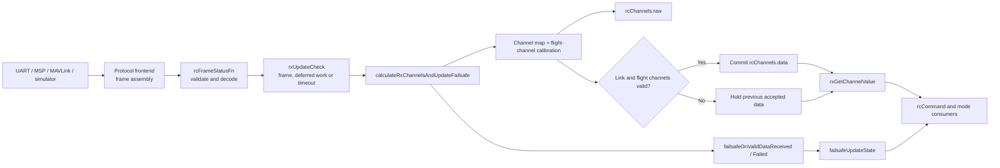
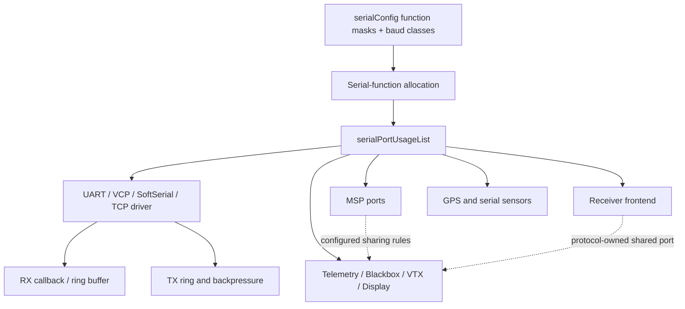
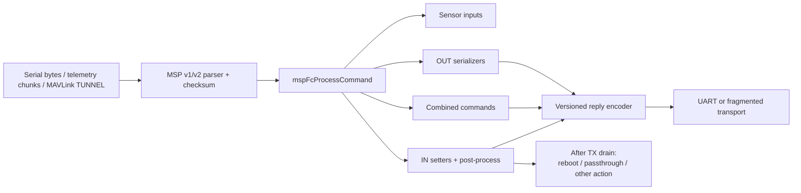
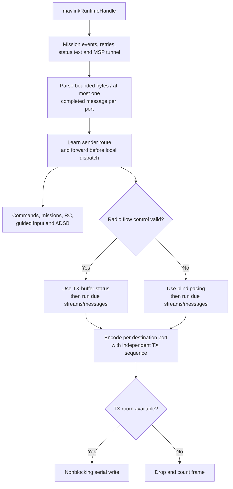

# 07 · RC, Serial & Communications

How INAV normalizes receiver protocols, assigns serial-port functions, handles MSP commands, schedules telemetry, and routes MAVLink traffic.

**[← Back to index](../README.md)** · Previous: [06 · Navigation & Missions](06-navigation-and-missions.md) · Next: [08 · OSD, Logging & Programming](08-osd-logging-and-programming.md)

---

## The model in one sentence

Protocol-specific frontends receive bytes or messages, scheduled backends normalize them into shared state, and common FC interfaces expose that state to control, configuration, telemetry, and ground stations.

Most protocol parsing runs in cooperative tasks; UART interrupt callbacks generally assemble frames and set flags rather than running flight logic.

## Communication contexts

| Context | Typical work | Design constraint |
|---|---|---|
| UART/DMA interrupt or receive callback | Byte framing, CRC prechecks, ring buffers, completion flags | Keep short; avoid heavy control work |
| Scheduler RX task | Decode/validate channels, failsafe, arming and modes | Event-driven with timeout fallback |
| Scheduler serial task | CLI and MSP parsing/dispatch | Processes bounded work per invocation |
| Telemetry tasks | Protocol state, polling and scheduled messages | Timing depends on priority and shared-port windows |
| MAVLink runtime | Parse budgets, routing, streams, commands, missions | Per-port state plus global transfer/tunnel ownership |
| Realtime/control context | Blackbox, ESC and selected shared devices | Must not introduce unbounded blocking |

## Receiver frontend/backend architecture

`rxRuntimeConfig_t` is the common receiver-backend contract:

- channel count and signal timeout;
- `rcFrameStatusFn()` to consume completed frames and return frame flags;
- `rcReadRawFn()` to return protocol-normalized channel values;
- optional `rcProcessFrameFn()` for deferred protocol work;
- optional channel/frame storage pointers;
- link-quality tracking.

See [`rx.h:150-167`](https://github.com/iNavFlight/inav/blob/7c2ac359401a839d0d70b9514630919f94314ff9/src/main/rx/rx.h#L150-L167). Frame flags distinguish no new frame, complete RC frame, receiver-reported failsafe, deferred processing, and dropped frames.

`serialRxInit()` selects serial providers such as Spektrum, SBUS/SBUS2, SUMD, IBUS, Jeti EX Bus, CRSF, FPort/FPort2/FBUS, SRXL2, GHST, and MAVLink, subject to compile guards. MSP, simulator, and none are separate receiver types.

### Typical data flow

### Protocol implementation patterns

| Protocol | Frontend/backend characteristics |
|---|---|
| SBUS | ISR synchronizes/copies frames; scheduled status decodes channels and link quality; SBUS2 shares port timing with telemetry |
| CRSF | ISR handles inter-byte timeout and length; task validates CRC, unpacks channels/link statistics; telemetry transmits in safe inter-frame gaps |
| FPort / FPort2 | Rings separate control and SmartPort traffic; deferred processing responds within protocol timing windows |
| GHST | CRC/frame completion signals deferred channel decode and telemetry processing |
| SRXL2 | Decoder plus bus handshake, baud switching, telemetry and link-recovery state machine |
| Jeti EX Bus | ISR distinguishes channel and telemetry frames; task decodes and meets short response window |
| MSP RX | `MSP_SET_RAW_RC` writes a frame store; no UART receiver frontend is needed |
| MAVLink RX | Already-parsed `RC_CHANNELS_OVERRIDE` messages feed the common backend with protocol-specific sentinel handling |
| SIM RX | Simulator setters expose channels, RSSI and explicit failsafe through the same contract |

## RC data ownership and validity

`rx.c` privately owns `rcChannel_t` entries with:

- `raw`: latest protocol sample after mapping/calibration;
- `data`: last accepted value used by consumers;
- `expiresAt`: channel timing metadata.

`calculateRxChannelsAndUpdateFailsafe()` performs the central pipeline ([`rx.c:445-552`](https://github.com/iNavFlight/inav/blob/7c2ac359401a839d0d70b9514630919f94314ff9/src/main/rx/rx.c#L445-L552)):

1. Run deferred protocol work.
2. Remap A/E/T/R inputs using `rcmap`.
3. Read protocol channels.
4. Calibrate the four flight channels and clamp accepted ranges.
5. Store samples in `.raw`.
6. Hold `.data` for invalid samples; prolonged invalid flight channels invalidate the flight-channel set.
7. Commit staged values only when link and flight channels are valid.
8. Apply MSP override and AUX overlay where active.
9. Notify failsafe of valid or failed data.

Two related conditions are distinct:

- `rxSignalReceived`: complete-frame/link freshness;
- `rxFlightChannelsValid`: validity of the four primary flight channels.

Both must be acceptable before new data is committed and valid-data failsafe notification occurs.

### Timeout processing

Even without a frame, `rxUpdateCheck()` forces processing every 100 ms so link expiration and failsafe continue to advance. The RX scheduler period therefore supports timeout/failsafe behavior as well as aging.

### Other RC writers

- **MSP override** has its own runtime/channel store and failsafe timing; selected channels can replace normal input while healthy.
- **MSP AUX overlay** writes designated AUX indices with its own no-update semantics.
- **Programming RC override** is applied at `rxGetChannelValue()`, downstream of the committed `.data` store.
- **RSSI/LQ** has separate ADC, RC-channel, protocol, and MSP source selection and timeouts.

### Failsafe entry

`failsafeOnValidDataReceived()` and `failsafeOnValidDataFailed()` timestamp/debounce link state. `failsafeUpdateState()` performs the actual RTH/land/drop/hold phase transitions. Full monitoring starts after a five-second power-on delay, not immediately at reset.

Suspending RX for operations such as EEPROM writes blocks normal channel processing and explicitly informs failsafe; resume restarts link-up timing.

## Serial-port and function allocation

INAV separates **port identifiers**, **configured functions**, and **open driver objects**.

### Persistent configuration

`serialPortConfig_t` stores a function bitmask plus separate MSP, GPS, telemetry, and peripheral baud indices. Function bits cover MSP, GPS, RX, Blackbox, telemetry variants, VTX, sensors, ESCs, display protocols, logging, gimbal, and serial outputs.

Stable identifiers include USART1–8 as 0–7, USB VCP as 20, and softserial 1/2 as 30/31 ([`io/serial.h:94-109`](https://github.com/iNavFlight/inav/blob/7c2ac359401a839d0d70b9514630919f94314ff9/src/main/io/serial.h#L94-L109)).

### Runtime ownership

`serialPortUsageList` tracks identifier, open `serialPort_t *`, and owning function. `openSerialPort()` refuses missing/already-owned identifiers, opens the driver, and records ownership.

Validation permits selected combinations, including:

- MSP with Blackbox, selected telemetry, or LOG;
- RX with LTM, IBUS, or MAVLink telemetry through protocol sharing checks;
- one to three MSP ports;
- protocol-owned CRSF/GHST/FPort/SRXL sharing.

Integrated protocols often reuse the RX-opened port internally rather than opening a second owner.

**Iterator pitfall:** several serial-config search helpers use file-global cursors. They are not independent/reentrant iterators; nested searches can perturb each other.

### Backpressure and service modes

The generic serial buffer writer can wait if no nonblocking bulk writer is available. Timing-sensitive protocols must check TX room before committing a frame.

CLI serial passthrough, GPS passthrough, and ESC 4-way programming deliberately enter special blocking modes, alter port callbacks/resources, and are guarded against unsafe armed use. They are not normal scheduled protocol tasks.

## CLI and MSP scheduling

The serial task runs at a nominal 100 Hz. When CLI is active it calls `cliProcess()`, but MSP processing continues. Non-MSP data handling differs while armed to avoid accidentally entering unsupported service behavior.

Entering CLI binds a buffered writer and sets an arming blocker. CLI setters and MSP setters mutate the same parameter-group storage; save/reset behavior is explicit. See [Configuration & Persistence](09-configuration-and-persistence.md).

## MSP protocol architecture

MSP (MultiWii Serial Protocol) is the primary configurator protocol. INAV separates wire transport (`msp/`) from FC command handlers (`fc/fc_msp.c`).

### Framing and port state

Each MSP port owns an independent parser, receive buffer, protocol version, command, flags, and checksum state. The parser accepts:

- MSP v1 `$M<` with XOR checksum;
- native MSP v2 `$X<` with CRC8-DVB-S2;
- MSP v2 encapsulated in v1 command 255, validating both layers.

Replies use the request's version, `>` for ACK and `!` for error.

Input and output buffers are bounded. Stream-buffer writes are not universally capacity-checked, so command handlers must size their output correctly; safe read/write variants and sticky overrun flags exist for parsing.

Transmission can be skipped for disconnected VCP or insufficient TX space. Jumbo responses have special buffer-empty behavior.

### Dispatch

`mspSerialProcessOnePort()` drains bytes until one complete command, processes at most one command per port per invocation, and runs post-process actions only after TX drain.

`mspFcProcessCommand()` dispatches broadly in this order ([`fc_msp.c:5171-5260`](https://github.com/iNavFlight/inav/blob/7c2ac359401a839d0d70b9514630919f94314ff9/src/main/fc/fc_msp.c#L5171-L5260)):

1. MSP sensor inputs, normally without reply.
2. Read-only/out commands.
3. Passthrough.
4. Reboot, disarmed only.
5. Combined in/out commands.
6. Write-only/in commands.

Handlers serialize core state directly rather than maintaining a separate MSP model. SET handlers often accept known prefixes of longer payloads for forward compatibility. Dangerous operations have armed-state and post-process guards.

### MSP flow

### MSP over telemetry and MAVLink tunnel

SmartPort/FPort and CRSF can carry chunked MSP messages with sequence/start/version/error metadata. They reconstruct requests, invoke the same FC dispatcher, and chunk replies.

The MAVLink v2 tunnel carries actual MSP wire frames in `TUNNEL` messages. It has per-ingress parser state, one global fragmented pending reply, sender/timeout handling, and restrictions on passthrough and non-reboot post-process actions. This is a transport bridge, not a second set of command semantics.

## Telemetry dispatcher

`telemetryInit()` initializes compiled protocols. The nominal 500 Hz task calls protocol state checks and handlers when not in CLI. Protocols read shared GPS, navigation, attitude, battery, mode, failsafe, RC, and sensor state directly.

| Protocol | Scheduling and transport pattern |
|---|---|
| CRSF | Rotating schedule; ad-hoc MSP/device replies have priority; RX driver sends in safe inter-frame gap |
| GHST | Scheduled battery/GPS data; actual transmission occurs in deferred RX processing |
| SRXL / SRXL2 | Mandatory QoS/RPM data plus rotating frames; request/buffer-driven timing |
| SmartPort / FPort | Receiver poll creates clear-to-send window; data-ID rotation and short service deadline |
| LTM | One-way normal/medium/slow schedules sized for baud budget |
| IBUS | Poll/response with half-duplex echo handling |
| HoTT | Poll/response binary sensors and optional text CMS |
| Jeti EX Bus | Valid request with short response deadline; stale requests discarded |
| SBUS2 | Cached sensor values plus dedicated slot-aligned high-rate task |
| SIM | Independent modem AT-command state machine |

**Shared-task caveat:** IBUS and HoTT can reschedule `TASK_TELEMETRY`, changing the cadence of the shared dispatcher, not only their own handler.

## MAVLink runtime

MAVLink support is a routed, multi-port subsystem behind a telemetry adapter. It includes streams, commands, missions, guided input, RC override, ADSB ingestion, high-latency behavior, and MSP tunneling.

### State ownership

Each `mavlinkPortRuntime_t` owns:

- serial/config/sharing and enabled state;
- radio flow-control state;
- parser and TX sequence;
- stream/message rates and due times;
- high-latency and MLRS state;
- dropped-frame counters.

The enclosing context owns all ports, route table, active-port pointers, send/receive messages, mission-transfer state, and optional MSP tunnel state ([`mavlink_internal.h:98-155`](https://github.com/iNavFlight/inav/blob/7c2ac359401a839d0d70b9514630919f94314ff9/src/main/mavlink/mavlink_internal.h#L98-L155)).

### Runtime pass

The implementation is centered in [`mavlink_runtime.c:229-358`](https://github.com/iNavFlight/inav/blob/7c2ac359401a839d0d70b9514630919f94314ff9/src/main/mavlink/mavlink_runtime.c#L229-L358).

### Routing

Routing:

- learns sender system/component pairs up to a bounded table;
- broadcasts untargeted traffic to other enabled ports;
- avoids forwarding back to ingress;
- uses generated message metadata for targeted local dispatch;
- preserves independent destination TX sequences.

### Active-port context

`mavActivePort`, `mavActiveConfig`, and `mavSendMask` are global context. Stream/send helpers require the correct active-port context and send mask. This is not a reentrant multi-port API; nested use must preserve context deliberately.

### Streams and flow control

Periodic rates can come from stream defaults or `MAV_CMD_SET_MESSAGE_INTERVAL` overrides, with caps. High-latency mode suppresses normal streams and periodically sends `HIGH_LATENCY2` on MAVLink 2.

Radio TX-buffer status drives flow control when valid; otherwise blind pacing applies. Messages are dropped rather than allowed to block indefinitely when TX space is insufficient.

### Missions and commands

Mission upload/download has one global transfer owner—sender system/component and ingress port—with bounded retries and timeouts. Armed aircraft reject mission replacement/clear.

Commands cover arming, RTH/landing, selected modes, home/position targets, message rates, high-latency mode, and capability queries. Guided inputs validate target/frame/ignore masks and require suitable navigation state.

## DroneCAN communication

DroneCAN uses libcanard and a global CAN state machine with `INIT`, `NORMAL`, `BUS_OFF`, and `FAILED` states. The 500 Hz medium-priority task drains TX, receives queued frames, dispatches transfers, drains handler-generated TX, checks asynchronous-request timeout, and performs 1 Hz maintenance.

| Component | Responsibility |
|---|---|
| CAN backend | F7 bxCAN, H7 FDCAN/classic-CAN configuration, or SITL SocketCAN; transmit/receive/status/bus-off recovery |
| Node-status table | Track live nodes, health/mode/uptime, expiry, and FC status broadcasts |
| DNA server | Dynamic node allocation and persistent UID-to-node assignments |
| GPS provider | Convert DroneCAN GNSS messages into `gpsSolDRV`, then use normal GPS publication |
| Battery provider | Convert BatteryInfo into the common battery backend |
| MSP integration | Node enumeration, node info, parameter GetSet, ExecuteOpcode and RestartNode |

Only one asynchronous service request may be pending; responses must match service, source node, and transfer ID and expire after a timeout. TX queue manipulation shared with interrupts uses CAN-priority atomic sections.

## Communications invariants and pitfalls

1. **Raw, accepted, and commanded RC values are different stages.** `raw`, `data`, and `rcCommand` must not be conflated.
2. **Link freshness and flight-channel validity are separate.** Both contribute to failsafe evidence.
3. **A timeout-driven RX run is useful work.** It advances expiration and failsafe even without a new frame.
4. **Serial function ownership is not the same as driver existence.** Configuration and protocol sharing determine the open port.
5. **Check TX capacity in timing-sensitive protocols.** Generic writes can block.
6. **MSP handlers own response sizing.** Bounded buffers and unchecked writes make this a safety requirement.
7. **Post-process actions wait for TX drain.** Reboot/passthrough behavior depends on that boundary.
8. **Telemetry timing can be shared.** Rescheduling the global task affects all protocols in the dispatcher.
9. **MAVLink active-port state is contextual, not reentrant.** Set and restore it deliberately.
10. **MAVLink drops rather than blocks under TX pressure.** Dropped-frame counters are meaningful diagnostics.
11. **Mission replacement has one transfer owner and armed guards.** Preserve this when adding transports.
12. **Interrupt-shared queues need explicit atomicity.** Do not assume cooperative scheduler rules protect interrupt-facing buffers.

## Navigation

**[← Back to index](../README.md)** · Previous: [06 · Navigation & Missions](06-navigation-and-missions.md) · Next: [08 · OSD, Logging & Programming](08-osd-logging-and-programming.md)
