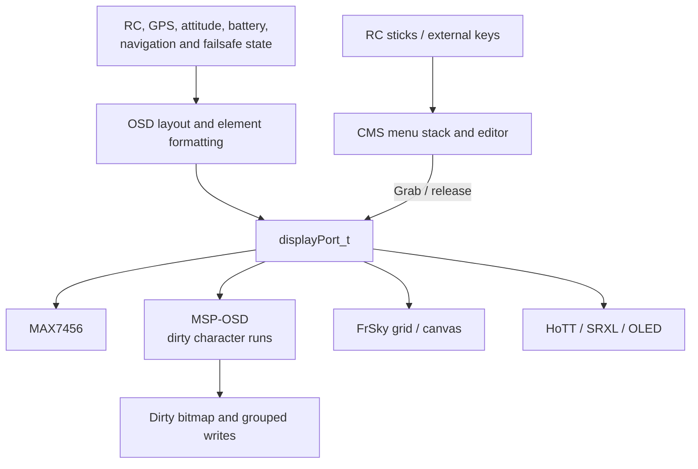
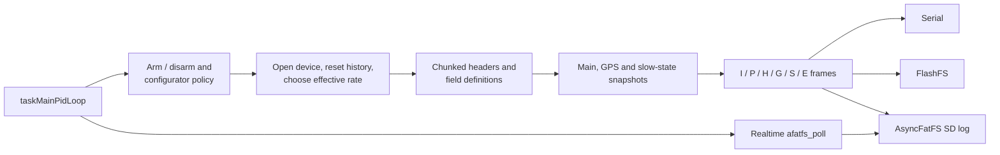
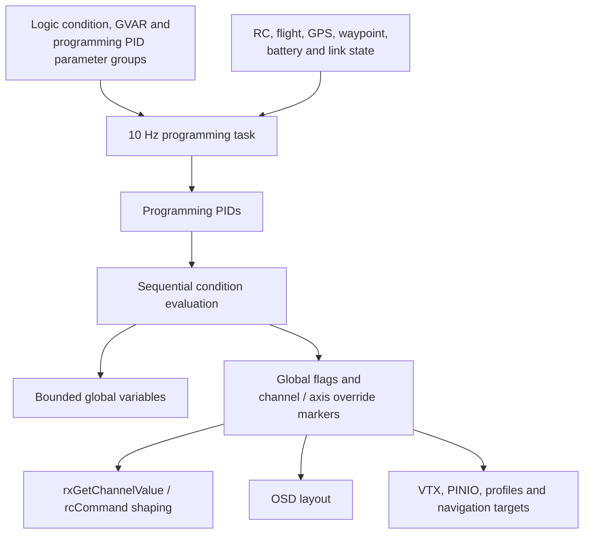

# 08 · OSD, Logging & Programming

How INAV presents flight state on displays, records Blackbox logs, evaluates user-programmable logic, exposes storage over USB, and schedules peripheral services.

**[← Back to index](../README.md)** · Previous: [07 · RC, Serial & Communications](07-communications.md) · Next: [09 · Configuration & Persistence](09-configuration-and-persistence.md)

---

## OSD and display architecture

OSD means On-Screen Display: flight data rendered into a video or external display. INAV separates OSD element/layout logic from display hardware through `displayPort_t`.

### Displayport contract

`displayPort_t` describes screen geometry, cursor state, grab count, supported attributes, and an optional device pointer. Its vtable covers:

- grab/release and clear/draw;
- character writes and attributes;
- transfer status, heartbeat and resynchronization;
- TX space, font metadata and readiness;
- transactions and optional pixel-canvas access.

See [`display.h:71-113`](https://github.com/iNavFlight/inav/blob/7c2ac359401a839d0d70b9514630919f94314ff9/src/main/drivers/display.h#L71-L113).

Backends include MAX7456 character OSD, legacy MSP displayport, buffered MSP-OSD, FrSky pixel/grid OSD, OLED dashboard, and HoTT/Spektrum text displays. Boot selects an available backend and registers it with OSD/CMS.

### OSD refresh pipeline

The nominal 250 Hz OSD task divides work rather than redrawing everything each invocation:

1. Avoid display buffers while a backend transfer is active.
2. Complete asynchronous readiness/font/canvas initialization.
3. Resolve layout override, alternative layouts, failsafe layout, or programming override.
4. Update statistics at a divided rate.
5. Alternate between recomputing elements and flushing display output.
6. Skip normal drawing while CMS owns the display.

OSD configuration combines common settings with per-layout packed item position/visibility words. Splash, armed, and post-disarm statistics screens temporarily replace normal element updates.

MSP-OSD maintains a local screen/attribute buffer and dirty bitmap. It sends changed character runs grouped by row/font/blink, then a draw command, instead of retransmitting the full screen continuously.

## CMS: configuration menu system

CMS is a declarative menu/editor layered over displayports. Menus are `CMS_Menu` structures with callbacks and arrays of `OSD_Entry` items such as labels, submenus, functions, booleans, integers, tabs, strings, and generic settings.

CMS owns registered displayports and a bounded menu stack. Opening it:

- selects and grabs a display;
- chooses normal or in-flight menus;
- disables servo output only for ground CMS;
- sets the appropriate arming blocker;
- computes small/large-screen layout.

Closing balances the actual display grab, resets menu state, restores servo output only if CMS disabled it, and optionally saves/reboots.

### In-flight CMS

In-flight CMS has stronger guards:

- opens only while armed in supported navigation modes without failsafe and after a switch hold;
- closes on switch release, disarm, failsafe, navigation-mode loss, inactivity, or panic-stick detection;
- exits without applying unconfirmed edits;
- neutralizes roll/pitch/yaw commands while active, but throttle and failsafe bookkeeping continue.

The scheduler entry is nominally 50 Hz, while CMS internally limits menu updates to 20 Hz.

## Blackbox architecture

Blackbox is INAV's flight-data recorder. It snapshots shared flight state, encodes complete and predicted frames, and writes to serial, onboard flash, SD card, or a SITL file.

### Sampling and lifecycle

`processBlackbox()` runs from the PID task, not as an independent scheduler task. Logging starts according to arming/configurator policy and finishes after disarm delay or explicit inhibition.

The state machine prepares the log, writes product/field/system headers incrementally, drains headers before running, emits flight frames/events, then writes an end marker and closes/flushes the device with bounded shutdown work.

### Frame model

| Frame | Purpose |
|---|---|
| I | Complete intra-frame snapshot |
| P | Predicted/delta inter-frame sample |
| H / G | GPS home and current solution |
| S | Slowly changing modes, RX/failsafe, temperatures, health and related state |
| E | Discrete events |

A three-entry main-state history supports previous and average predictors. P-frame selection follows the configured rate numerator/denominator. Effective logging is capped to a supported maximum rate.

### Encoding invariant

Field definitions and writer order must match **exactly**. Header declarations do not perform encoding; `writeIntraframe()` and `writeInterframe()` must implement the declared fields, predictors, and encodings in the same order ([`blackbox.c:254-260`](https://github.com/iNavFlight/inav/blob/7c2ac359401a839d0d70b9514630919f94314ff9/src/main/blackbox/blackbox.c#L254-L260)).

Conditional field tests are cached at log start so fields cannot appear/disappear midway through a log. Encodings include variable-byte integers, zigzag, tagged small deltas, and fixed-width values.

Pause/resume keeps iteration timing coherent and resumes on an I-frame boundary with an event.

### Backpressure and storage

`blackboxWrite()` dispatches to serial, FlashFS, AsyncFatFS, or SITL file. Header output uses replenished budgets based on free buffer space and per-iteration limits. Reservation distinguishes temporary backpressure from an item too large ever to fit.

- **FlashFS:** append-only stream over NOR/NAND with asynchronous page writes; bits only transition 1→0 until erased.
- **SD:** AsyncFatFS callbacks for directory, creation, writes, close and deletion; `afatfs_poll()` must run frequently from realtime callbacks.
- **Serial:** can share/displace MSP under configured ownership rules and is rate-limited to reduce receiver overruns.
- **Terrain sharing:** SD access is lent to terrain only when AsyncFatFS is idle.

## Programming framework

The programming framework lets users configure logic without writing C. It includes logic conditions, global variables, programming PID controllers, output-profile actions, and overrides into existing FC interfaces.

### Logic conditions

A persistent `logicCondition_t` contains two typed operands, enable, activator, operation, and flags. Operand sources include constants, RC channels, flight state/modes, other conditions, global variables, programming PIDs, and waypoint state.

The 10 Hz programming task runs programming PIDs, output profiles, then logic conditions in index order. A condition evaluates only when enabled, its activator is true, and CLI is inactive.

Operations include comparisons, Boolean logic, sticky/edge/delay/timer/delta functions, arithmetic, global-variable access, PINIO, VTX, OSD layout, RC/flight-axis overrides, profile changes, heading/altitude targets, and RTH/landing activation.

### Evaluation-order and timing rules

At the start of an update, global flags and per-channel/axis active markers are cleared; active conditions must reassert them.

- Conditions run in index order. A lower-index reference sees this tick's value; a forward reference sees the previous tick's stored value.
- Overrides are recomputed at 10 Hz, while RX and control loops can run much faster. An override can persist between programming ticks and has removal latency.
- Latch flags prevent repeated transitions after being set.

### Global variables and programming PIDs

Global variables are bounded `int32_t` slots. Their min/max/default configuration is persistent; current values are separate runtime state. `gvSet()` clamps to configured bounds, and boot initializes values from defaults. Arm/disarm logic-state reset does not automatically reset every global-variable value.

Programming PIDs reuse the operand resolver and produce normalized outputs. Configuration edits reinitialize their runtime controller state.

### Multifunction is a separate feature

`fc/multifunction.c` implements an OSD-guided selector for actions such as emergency landing, safehome/trackback suspend, turtle mode, emergency arming, and compass/heading operations. It is distinct from logic conditions and has no dedicated task; selection runs through OSD evaluation, so OSD scheduling affects its timing.

## USB mass storage

USB MSC is a **dedicated boot service mode**, not a filesystem server running beside flight control.

The CLI `msc` command verifies storage, stops motors, and requests a reset. On the next boot INAV:

1. Skips conflicting early VCP setup.
2. Prepares MSC buttons/storage.
3. Scans onboard flash before starting USB to avoid host timeouts.
4. Starts the USB mass-storage class.
5. Waits in the MSC service loop without starting the normal scheduler.

### Onboard flash: virtual read-only FAT

For onboard FlashFS, INAV constructs an emulated FAT filesystem:

- recognizes Blackbox headers and exposes individual log files;
- exposes an aggregate log;
- adds informational files;
- services reads through absolute FlashFS reads;
- rejects writes and marks the volume write-protected.

### SD card: physical block access

The SD backend exposes real capacity and can permit writes. Block operations use timeouts, and some platforms need aligned bounce buffers.

Because the scheduler is not running, MSC is not a live view of an actively written log. SD writes can modify the card's filesystem and must be treated accordingly.

## Terrain services

Terrain support combines SD-backed map data, an LRU cache, navigation-facing queries, and a separate fixed-wing AGL-hold wrapper.

### Data and tasks

Map blocks contain validity bitmaps, location/index metadata, CRC/version, and packed height samples. Blocks transition through invalid, disk-wait, reading, and valid states; a block being read cannot be evicted or returned as usable.

| Task | Rate | Responsibility |
|---|---:|---|
| `TERRAIN` | 5 Hz | Current/home heights and interpolation |
| `TERRAIN_IO` | 50 Hz | Open/seek/read/close state machine and cache loads |

SD operations coordinate with Blackbox and release access between sectors. A block becomes valid only after expected indices, CRC, format version, and spacing match.

Navigation-facing APIs return explicit success and write outputs only on success. If map data is lost during a hold, the fixed-wing terrain-hold core freezes its altitude target rather than descending on stale data.

Map-based fixed-wing AGL hold is distinct from rangefinder-driven `SURFACE` terrain following.

## ADSB traffic tracking

ADSB maintains a fixed table of nearby aircraft with position, range/bearing, vertical separation, optional closest-point-of-approach prediction, counters, and time-to-live.

MAVLink `ADSB_VEHICLE` messages feed a module-owned scratch structure. The 500 ms idle-priority task recalculates live entries and decrements TTL once per elapsed second.

OSD/MSP queries can select the nearest qualifying vehicle or prioritize earliest predicted entry into an alert radius. Reports require valid identity/coordinates/altitude, and distance calculations require a suitable own GPS/estimated fix. Entries expire through TTL or range limits.

## Gimbal and headtracking

Gimbal and headtracker modules use singleton devices plus vtables. Separate 50 Hz tasks service them, although serial/MSP receive callbacks perform actual sample acquisition for some backends.

The serial-gimbal path periodically constructs a checksummed attitude packet from RC channels, trims, lock/center mode, sensitivity, or valid headtracker attitude. A shared UART can feed both gimbal and headtracker parsers, or a separate headtracker function port can be configured.

Incoming headtracker packets require header/CRC validation and have expiry. In headtracker mode, invalid or expired tracking falls back to trimmed center rather than holding stale angles indefinitely.

## VTX control

VTX control normalizes SmartAudio, Tramp, FuriousFPV, and MSP/CRSF devices behind `vtxDevice_t` and a common vtable. A single active device pointer exposes capabilities and current band/channel/power/pit state.

The 5 Hz task polls control inputs, reconciles one category—power, band/channel, or pit mode—in round-robin order, then runs the backend protocol state machine.

Public band/channel numbers are one-based; power indices are zero-based. Runtime settings can force low power while disarmed, including until first arm, but not during failsafe.

## LED strip

LED-strip configuration maps per-LED position, function, overlay, and color into HSV output. Base functions include flight mode, battery, RSSI, GPS, and thrust ring; overlays have independent timing.

The 100 Hz idle-priority task rebuilds colors when layer timers fire and requests one WS2811 update. The driver owns HSV data, timer/DMA resources, and split transfer buffers.

A new update is skipped while DMA is active. The driver enforces the required reset gap and avoids CPU writes racing active DMA.

## PINIO and PINIOBOX

PINIO exposes user outputs as GPIO or timer PWM. Runtime state separates pin/timer ownership, inversion, RC-box state, and stored duty.

There is no dedicated PINIO task:

- hardware initializes at boot;
- `pinioBoxUpdate()` runs after mode activation in RX processing;
- programming logic can independently set duty.

PWM initialization refuses timers shared with fixed-period LED/beeper outputs. Deactivation forces 0% without destroying stored duty so reactivation restores the configured level.

## Additional I/O patterns

| Module | Architectural role | Scheduling/ownership note |
|---|---|---|
| SmartPort master | Actively discovers/polls external sensors and caches time-stamped values | 500 Hz task alternates polling and receive; getters reject stale data |
| CRSF sensor input | Converts external GPS/baro/vario/battery frames into common sensor backends | UART assembles frames; task copies completed frame atomically before decode |
| Servo SBUS / motor SRXL2 | Serial actuator backends behind common output APIs | 200 Hz output-driver task; control values staged by mixers |
| RC device / display input | Connects radio/display UI and CMS joystick paths | Task enablement depends on PINIO/OSD/device configuration |
| AsyncFatFS | Cooperative FAT/SD operations for Blackbox and terrain | Polled from realtime callbacks; users coordinate exclusive device access |

## I/O invariants and pitfalls

1. **Do not touch display buffers during backend transfer.** Display readiness/transfer state is part of correctness.
2. **CMS display grabs suppress normal OSD drawing.** Balance grabs exactly and preserve in-flight guards.
3. **Blackbox field declarations and encoders are one contract.** Change both together and test decoded logs.
4. **Conditional Blackbox fields are fixed at log start.** Do not make layout depend on mid-log state.
5. **Storage operations need backpressure and polling.** A queued write is not necessarily persisted.
6. **Programming-condition order affects results.** Forward references use previous-tick values.
7. **Programming overrides have 10 Hz latency.** Do not treat them as sample-synchronous control updates.
8. **MSC is a separate boot mode.** Normal flight tasks and live logging are not running.
9. **Terrain success is explicit.** Never consume sentinel/stale map data as valid altitude.
10. **Peripheral freshness needs fallback.** Headtracker, ADSB, SmartPort and protocol sensors each define their own expiry rules.
11. **DMA-backed outputs need ownership discipline.** LED and actuator updates must not race active transfers.
12. **OSD evaluation can drive multifunction timing.** A feature without a task still has a real execution context.

## Navigation

**[← Back to index](../README.md)** · Previous: [07 · RC, Serial & Communications](07-communications.md) · Next: [09 · Configuration & Persistence](09-configuration-and-persistence.md)
