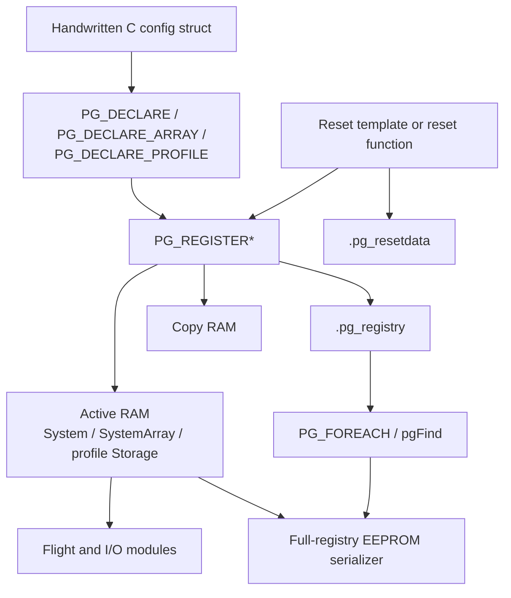
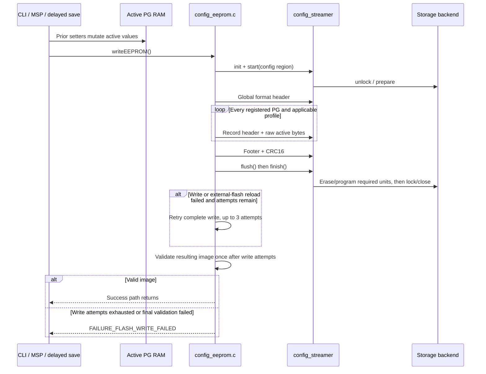
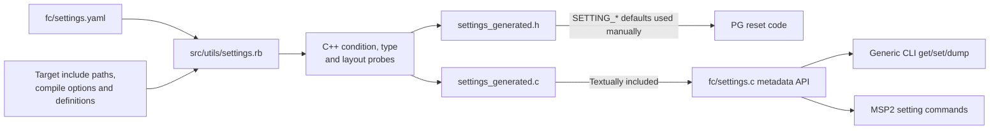

# 09 · Configuration & Persistence

How INAV owns configuration in parameter groups, exposes selected fields through generated CLI/MSP metadata, and serializes complete configuration images to flash or other storage.

**[← Back to index](../README.md)** · Previous: [08 · OSD, Logging & Programming](08-osd-logging-and-programming.md) · Next: [10 · Build, Targets & Testing](10-build-targets-and-testing.md)

---

## The model in one sentence

Handwritten C structures and registration macros own persistent data; linker-discovered registries let a generic serializer save every group, while `settings.yaml` generates metadata for exposing selected fields to CLI and MSP.

These are related but separate systems. Adding a field to YAML does not create a C structure, register a parameter group, or connect a reset default.

## Four configuration categories

| Category | Examples | Persistent? | Owner |
|---|---|---:|---|
| Parameter-group data | Gyro config, serial config, mixer profiles, PID profiles | Yes | Registering module plus generic PG/EEPROM code |
| Generated setting metadata | CLI name, type, range, lookup table, documentation description | Generated per target, not user data | `settings.yaml` and `settings.rb` |
| Latched runtime configuration | Active feature mask, selected pointers, derived values | Usually no | Initialization/activation code |
| Runtime flight state | Arming flags, flight modes, logic outputs, current global-variable values | No unless separately represented in a PG | Owning runtime module |

## Parameter-group architecture

PG means Parameter Group: one registered persistent C structure, array, or true-profile object with a stable number, version, active RAM, copy RAM, and reset behavior.

`pgRegistry_t` contains ([`parameter_group.h:44-54`](https://github.com/iNavFlight/inav/blob/7c2ac359401a839d0d70b9514630919f94314ff9/src/main/config/parameter_group.h#L44-L54)):

- PGN plus encoded version;
- size plus system/profile classification;
- active RAM address;
- backup-copy RAM address;
- optional current-profile pointer;
- reset template pointer or reset-function pointer.

Registry entries live in `.pg_registry`; reset templates live in `.pg_resetdata`. Linker start/end symbols let `PG_FOREACH` discover them without a central list.



## Declaration and registration forms

| Kind | Declaration | Registration options | Storage generated |
|---|---|---|---|
| Scalar/system | `PG_DECLARE` | `PG_REGISTER`, `PG_REGISTER_WITH_RESET_FN`, `PG_REGISTER_WITH_RESET_TEMPLATE` | `<name>_System`, `<name>_Copy` |
| System array | `PG_DECLARE_ARRAY` | `PG_REGISTER_ARRAY`, `PG_REGISTER_ARRAY_WITH_RESET_FN` | `<name>_SystemArray[N]`, `<name>_CopyArray[N]` |
| True profile | `PG_DECLARE_PROFILE` | `PG_REGISTER_PROFILE`, `PG_REGISTER_PROFILE_WITH_RESET_FN`, `PG_REGISTER_PROFILE_WITH_RESET_TEMPLATE` | Profile storage, copy storage and current pointer |

The exact macros are in [`parameter_group.h:104-231`](https://github.com/iNavFlight/inav/blob/7c2ac359401a839d0d70b9514630919f94314ff9/src/main/config/parameter_group.h#L104-L231).

There is no general `PG_REGISTER_ARRAY_WITH_RESET_TEMPLATE` in this snapshot. Arrays normally use a reset function that initializes every element.

### Accessors

Declaration macros create inline accessors:

- `name()` returns a const pointer by API convention;
- `nameMutable()` returns writable active storage;
- array `name(index)` and `nameMutable(index)` select an element;
- `name_array()` exposes the entire system array;
- true-profile `name()` dereferences the currently active profile pointer.

The underlying objects are not C `const`; constness documents normal read/write ownership at the accessor boundary.

## Active RAM versus copy RAM

Active `_System`, `_SystemArray`, or profile storage is authoritative mutable runtime configuration. EEPROM writes serialize these active addresses.

Copy storage is **not** a transactional dirty/save buffer. The CLI dump/diff path uses it to:

1. Back up active values.
2. Temporarily reset active storage to defaults.
3. Compare active/default and copy/current values.
4. Restore active values afterwards.

Generated settings resolve a PG and add a field offset into either active or copy storage. The metadata itself owns no user value.

## Reset behavior

`PG_RESET_TEMPLATE` emits a const default structure into `.pg_resetdata`. Reset-function registration expects `pgResetFn_<name>()`.

Every reset begins by zeroing the destination. PG code then:

1. Copies a template if the reset pointer lies in the reset-data section.
2. Otherwise invokes a non-null reset function.
3. Leaves zero defaults if the reset pointer is null.

Operations have specific scope:

- `pgReset()`: one system object/array or one true-profile slot;
- `PG_RESET_CURRENT()`: system storage or currently selected true profile;
- `pgResetAll()`: every system group and requested true-profile slots;
- `pgActivateProfile()`: rebind every true-profile current pointer.

`RESET_CONFIG` helpers in `config_reset.h` are conveniences for building local defaults, not another persistence mechanism.

## PGNs, versions, sizes, and profiles

Registry bit allocation is:

| Field | Allocation |
|---|---|
| PGN | Low 12 bits; valid range up to 4095, with reserved/test values |
| PG version | Top 4 bits of registry `pgn`; range 0–15 |
| Structure size | Low 12 bits of `size` |
| Profile classification | High profile flag in `size` |

PGN 0 is invalid. Existing allocation ranges and reserved historical IDs are listed in `parameter_group_ids.h`. PGNs must remain unique and stable because they are persistent record keys.

`pgFind()` compares the 12-bit PGN, not the encoded version. Duplicate PGNs would therefore make lookup ambiguous.

### True profiles versus array-backed profiles

| Mechanism | EEPROM behavior | Selection |
|---|---|---|
| True profile PG | One record per profile | `pgActivateProfile()` updates current pointers |
| System array PG | One system record containing the whole array | Module-specific pointer/index |

PID and EZ-Tune use true profiles. Control, battery, and mixer profiles use system arrays with module-specific current selection.

Generated settings support both through section-specific offset calculations. YAML's value/section type controls addressing; it does not change the PG's persistent classification.

## EEPROM image format

The persisted stream is:

```text
configHeader_t
    uint8_t format                    # EEPROM_CONF_VERSION

zero or more configRecord_t records
    uint16_t size                     # 6-byte header + payload
    uint16_t pgn                      # bare PGN, no registry version bits
    uint8_t  version                  # PG version
    uint8_t  flags                    # system or profile classification
    uint8_t  pg[size - 6]             # raw active C-structure bytes

configFooter_t
    uint16_t terminator = 0

uint16_t crc                          # CRC-16/CCITT over preceding content
```

Definitions are in [`config_eeprom.c:44-78`](https://github.com/iNavFlight/inav/blob/7c2ac359401a839d0d70b9514630919f94314ff9/src/main/config/config_eeprom.c#L44-L78).

The global container format version is separate from firmware version and each PG version. The CRC covers the header, records, and footer, not the appended CRC itself.

**Portability limitation:** payloads are raw RAM bytes, including native padding and build-dependent structure layout. This is not a field-oriented portable encoding.

## Load and version fallback

`isEEPROMContentValid()` verifies exact global format, record bounds/sizes, and CRC. Loading then scans records by PGN and classification.

`pgLoad()` always resets the destination first. It copies stored bytes only when the stored PG version exactly matches the registered version ([`parameter_group.c:86-94`](https://github.com/iNavFlight/inav/blob/7c2ac359401a839d0d70b9514630919f94314ff9/src/main/config/parameter_group.c#L86-L94)):

```text
reset destination to defaults
if stored version == registered version:
    copy MIN(stored payload size, current structure size)
else:
    retain defaults
```

| Persisted condition | Result |
|---|---|
| Record missing | Group instance remains at defaults |
| Version mismatch | Entire group instance remains at defaults |
| Same version, stored size smaller | Prefix copied; remaining bytes retain reset defaults |
| Same version, stored size larger | Only current structure size copied |
| Unknown PGN | Ignored by registered groups |
| Invalid global format/bounds/CRC | Whole configuration reset and rewritten during boot recovery |

This is fallback behavior, not a general field-by-field migration engine.

### Size matching is intentionally not strict

Equal version does not require equal size. Carefully designed tail appends can preserve old values, but old tail padding can overwrite a new field's default. The safe default contributor rule is to increment PG version on structure-layout changes and accept reset of that group rather than risk misinterpretation.

## Global reset versus individual-group reset

Startup performs:

1. Optional external-flash initialization.
2. `initEEPROM()`.
3. `ensureEEPROMContainsValidData()`.
4. `readEEPROM()`.

If the global image is invalid, `resetEEPROM()` calls `resetConfigs()`, writes a fresh image, and then startup reads it.

`resetConfigs()` does more than `pgResetAll()`:

- resets all system groups and true-profile slots;
- activates profile zero;
- runs `createDefaultConfig()` for radio mapping, default features, target overlays, and optional MSP defaults;
- restores profile-dependent state.

An individual PG version mismatch inside an otherwise valid image only invokes that group's reset behavior. It does **not** rerun the full target/default overlay process.

After loading, `readEEPROM()` selects configured control/battery/mixer profiles, validates and fixes configuration, and activates derived runtime state.

### Validation is not migration

`validateAndFixConfig()` performs semantic normalization, target validation, and generated-settings range checks. Out-of-range settings can set an arming blocker; they do not automatically trigger PG reset or an EEPROM rewrite.

Configurator-side CLI backup migration is a separate workflow, not firmware PG migration.

## Save serialization

`writeSettingsToEEPROM()` walks the complete registry:

- system groups produce one record from active storage;
- true profiles produce one record per profile slot;
- record size includes its six-byte header;
- PGN/version come from the registry;
- footer and CRC follow all records.

Every save serializes the complete registry; it is not an incremental per-setting update.

### Save sequence



The write path can enable circular DShot DMA so zero-throttle packets continue during blocking flash operations. The write/external-flash-reload path has up to three attempts; after those attempts, `isEEPROMContentValid()` runs once. A final content-validation failure is **not** retried and enters `FAILURE_FLASH_WRITE_FAILED` ([`config_eeprom.c:323-354`](https://github.com/iNavFlight/inav/blob/7c2ac359401a839d0d70b9514630919f94314ff9/src/main/config/config_eeprom.c#L323-L354)). External-flash writes reload the RAM mirror as part of each write attempt. At the FC layer, save-and-notify writes and then rereads/reactivates configuration. Delayed save requests coalesce until processed while disarmed.

## Configuration streamer and backends

The common streamer lifecycle is:

1. Initialize state.
2. Establish config base/end and unlock the backend.
3. Accumulate bytes and program full backend-sized chunks.
4. Zero-pad and flush a final partial chunk.
5. Lock/finish the backend.

Writes are bounds-checked against the configured region.

| Backend | Behavior |
|---|---|
| STM32F4/F7 | Unlock, sector erase at boundaries, word programming |
| STM32H7 | Bank/sector erase and complete flash-word programming |
| AT32F43x | Sector/page-boundary erase and word programming |
| External flash | RAM mirror mapped to a physical config partition, sector erase and page program |
| RAM | Clear on first write, then copy buffered words |
| SITL host file | Load/create on unlock; write full EEPROM buffer and close on lock |
| RP2350 | Erase XIP config region, aggregate into 256-byte pages, flush partial page on lock |

Internal-flash layouts obtain `__config_start/end` from linker symbols. RAM, host-file, and external-flash configurations map equivalent symbols over a RAM buffer.

## Generated settings system

### What YAML contributes

`fc/settings.yaml` contains named lookup tables, shared constants, and ordered groups. A group supplies:

- PGN macro and C structure type;
- required headers and optional compile condition;
- optional value/section type;
- members with CLI/MSP name, description, field path, default, range or lookup table, and optional condition.

Field paths can traverse nested structures and arrays. The generator emits `offsetof()`-based metadata.

### Generation flow



Generation is target-specific because conditions and structure layout depend on compile definitions. The generated C file is textually included by `fc/settings.c`.

### Generated header and implementation

The header supplies setting counts, lookup declarations, numeric setting indices, and `SETTING_<NAME>_DEFAULT`, `_MIN`, and `_MAX` macros where applicable. Handwritten reset code must consume those defaults manually.

The implementation contains compact metadata:

- PGN/count arrays aligned with table order;
- compressed setting names;
- enabled lookup tables;
- deduplicated min/max values;
- packed `setting_t` entries with type, section/mode and offset.

Generated setting indices are not persistent identities. They can change with YAML order or build conditions. MSP supports name- and index-based lookup plus metadata/PG discovery.

### Special defaults

`:zero` and `:target` intentionally avoid ordinary generated default macros; C reset code supplies those defaults. Editing YAML alone does not initialize the corresponding PG field.

## CLI and MSP setting paths

### CLI

Generic `set` resolves metadata, parses direct values or lookup names, checks ranges, and writes active PG RAM. It does not persist every assignment immediately.

- `save` writes EEPROM and reboots.
- `defaults` resets and writes, normally followed by reboot.
- `dump`/`diff` use the copy/reset/restore mechanism.
- Special commands for features, logic, mixer rules, waypoints, and other structures can configure PGs not exposed as generated scalar settings.

### MSP

Generic v2 commands support setting read, setting write, setting metadata, and PG-list discovery. Requests can identify a setting by name or generated index.

Like CLI `set`, `MSP2_COMMON_SET_SETTING` changes active RAM but does not save. Persistence and reset are explicit disarmed-only commands:

- `MSP_EEPROM_WRITE`: write, reread and reactivate;
- `MSP_RESET_CONF`: reset, write, reread and reactivate.

## Features and runtime state

`featureConfig_t` is a system PG containing a feature bitmask. The API deliberately distinguishes:

- `featureConfigured(mask)`: live persisted configuration;
- `feature(mask)`: separate latched active-feature mask;
- `featureSet/Clear/ClearAll`: mutate live PG configuration only.

The latch is taken during initialization. Feature setters do not automatically update it, so runtime consumers of `feature()` must not be assumed to change immediately after an edit.

Arming flags, flight-mode flags, state flags, enabled-sensor flags, logic outputs, and current global-variable values are separate runtime state, not implicit PG data.

## Programmable logic configuration example

The programming framework illustrates the separation:

- logic-condition definitions are a persistent array;
- logic-condition runtime states and global flags are separate;
- global-variable min/max/default configuration is persistent;
- actual global-variable values are runtime-only;
- programming-PID configuration is persistent, with separate runtime controller/output state.

CLI edits generally change persistent configuration, while a runtime MSP GVAR setter changes current runtime value. Read the specific API rather than assuming every setter has the same persistence behavior.

## Configuration invariants and pitfalls

1. **PGN is the persistent identity; generated setting index is not.** Keep PGNs unique and stable.
2. **PG version is four bits.** Layout changes need deliberate versioning within 0–15.
3. **Raw C bytes are serialized.** Avoid pointers and runtime-only objects in PG structures; account for packing/alignment and build conditions.
4. **Version mismatch resets the whole group instance.** It does not invoke a generic migration engine.
5. **Equal version with unequal size copies a prefix.** Tail append compatibility must account for old padding and defaults.
6. **Copy RAM is for CLI diffing, not save transactions.** Do not treat it as authoritative active data.
7. **Array reset functions must initialize every element.** Registration covers the entire array as one record.
8. **True profiles and system arrays are different models.** Selection and EEPROM record layout differ.
9. **YAML does not create persistence or defaults.** C structure, registration, reset code and YAML must be kept synchronized.
10. **Generated settings are target-specific.** Do not share generated output across targets with different conditions/layouts.
11. **Set is not save.** CLI/MSP setters mutate active RAM; persistence is explicit.
12. **Feature configuration and latched active features differ.** Re-latch/reinitialize when required rather than assuming immediate effect.
13. **A full default reset includes target overlays; an individual PG reset does not.** Test both paths.
14. **Flash writes can block and fail.** Preserve retry, validation, RX suspension, delayed-save, and output-safety behavior.

## Navigation

**[← Back to index](../README.md)** · Previous: [08 · OSD, Logging & Programming](08-osd-logging-and-programming.md) · Next: [10 · Build, Targets & Testing](10-build-targets-and-testing.md)
