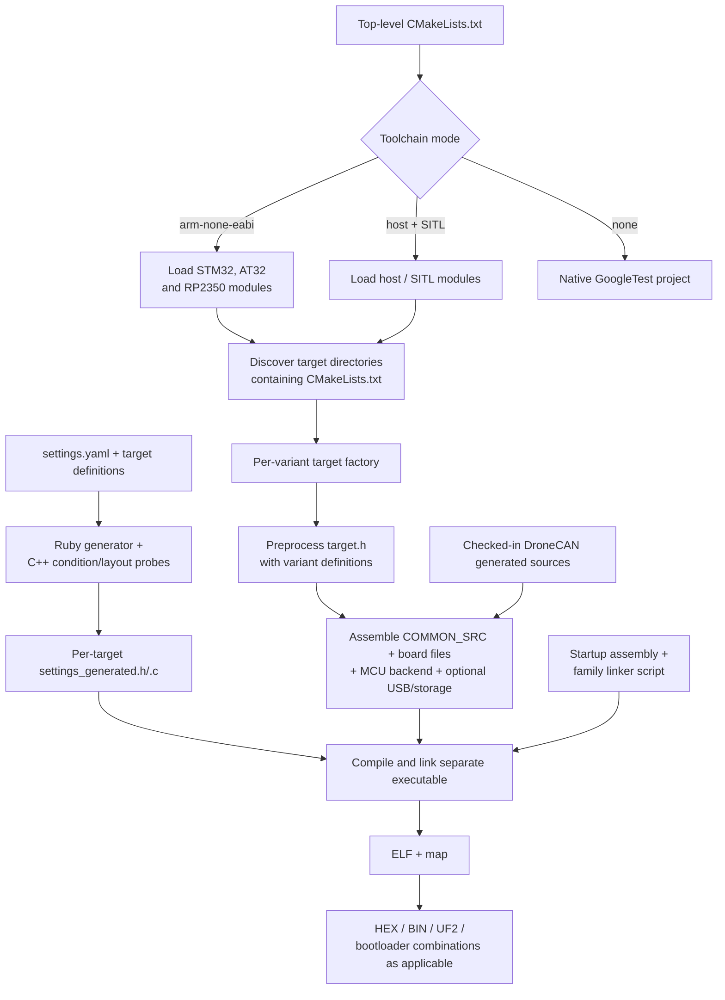
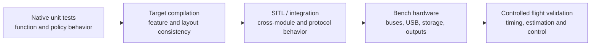

# 10 · Build, Targets & Testing

How CMake composes one firmware executable per board variant, selects MCU/host backends and generated sources, and how native tests and SITL fit into verification.

**[← Back to index](../README.md)** · Previous: [09 · Configuration & Persistence](09-configuration-and-persistence.md) · Next: [11 · Extending INAV](11-extending-inav.md)

---

## The model in one sentence

INAV's build is **per-target compile-time composition**: every board variant gets its own executable, preprocessor definitions, generated settings, board/MCU source selection, startup/linker layout, and artifacts.

Shared source files are reused textually, not compiled once into a board-independent flight library.

## Top-level build flow

The root [`CMakeLists.txt`](https://github.com/iNavFlight/inav/blob/7c2ac359401a839d0d70b9514630919f94314ff9/CMakeLists.txt) selects among three modes:

| Mode | Selection | Result |
|---|---|---|
| ARM firmware | Default `arm-none-eabi` toolchain | STM32, AT32 and RP2350 target factories become active |
| SITL | `SITL=ON`, default `host` toolchain | Native host executable with SITL replacements |
| Native tests | `TOOLCHAIN=none` | Enters `src/test` instead of firmware targets |

Representative CMake entry points, run from the INAV repository root after installing the prerequisites described by the upstream development documentation, are:

```bash
# One named firmware target
cmake -S . -B build -DCMAKE_BUILD_TYPE=Release
cmake --build build --target MATEKF722SE

# Native unit tests through the check target
cmake -S . -B build-tests -DTOOLCHAIN=none -DCMAKE_BUILD_TYPE=Debug
cmake --build build-tests --target check

# Host SITL executable
cmake -S . -B build-sitl -DSITL=ON -DCMAKE_BUILD_TYPE=Debug
cmake --build build-sitl --target SITL
```

These are entry points rather than a complete build guide. Target selection occurs at build time, and the compiler/tooling side effects described under [Build-system cautions](#build-system-cautions) still apply.

The root file also:

- reads Git HEAD and shortens it for the firmware revision;
- declares the INAV version (10.0.0 in this snapshot);
- selects C99 normally, C11 where host/platform requirements need it, and C++11 for tests;
- loads settings, target, platform, debug and CI helpers;
- enters `src/`, discovers targets, and collects release targets.

The expected ARM cross-compiler in this tree is GCC/`arm-none-eabi` 13.2.1, checked by `cmake/arm-none-eabi-checks.cmake`.

## Target discovery and composition



### Discovery rules

`src/main/target/CMakeLists.txt` adds every board directory containing a `CMakeLists.txt`. Each target factory immediately returns if its required toolchain is inactive, so the same configuration logic can cover all platforms while producing only relevant targets.

`collect_targets()` sorts valid targets, removes `SKIP_RELEASES` entries from the release set, and creates convenience targets. `SKIP_RELEASES` does not necessarily make a target unbuildable; it controls release/CI inclusion.

### Per-board source set

For an STM32-family target, composition typically includes:

1. MCU startup assembly and linker script.
2. Architecture flags and MCU definitions.
3. Vendor HAL/StdPeriph and selected CMSIS-DSP sources.
4. Every C/header file in the board directory.
5. `COMMON_SRC` from `src/main/CMakeLists.txt`.
6. Optional USB, VCP, SD, FlashFS and MSC sources detected from target macros.
7. Checked-in DroneCAN generated sources when enabled by common composition.
8. Per-target generated settings.

`setup_executable()` adds generated include paths, target/version definitions, warnings, output directories, and release LTO. The variant name is defined both as a string revision value and as a bare preprocessor symbol, enabling `#ifdef VARIANT` board differences.

AT32 mirrors this structure. RP2350 and SITL instead use exclusion lists and replacement backends where generic STM32-oriented implementations are inappropriate.

## Why each variant recompiles shared code

Board macros affect:

- which functions and drivers exist;
- structure layouts under feature guards;
- generated setting tables and defaults;
- static array sizes and resource limits;
- hardware descriptors and register types;
- linker sections and memory attributes.

Therefore, object files and generated settings from one target cannot safely be reused for another. This is a deliberate simplicity/correctness trade at the cost of build time.

## Target snapshot

Static target-factory counts in this source snapshot are:

| Platform/factory | Variants | Excluded from release set | Release-eligible |
|---|---:|---:|---:|
| STM32F405xg | 121 | 31 | 90 |
| STM32F411xe | 17 | 17 | 0 |
| STM32F427xg | 1 | 0 | 1 |
| STM32F722xe | 88 | 11 | 77 |
| STM32F745xg | 15 | 1 | 14 |
| STM32F765xg/xi | 4 | 0 | 4 |
| STM32H743xi | 55 | 4 | 51 |
| AT32F43x xMT7 | 2 | 0 | 2 |
| AT32F43x xGT7 | 12 | 1 | 11 |
| RP2350 | 1 | 0 | 1 |
| **ARM total** | **316** | **65** | **251** |
| SITL, separate host mode | 1 | 0 | 1 |

These are source declarations, not a claim that every image was compiled or hardware-tested for this analysis. The F411 release exclusions match the upstream warning that F411 is no longer accepted for new official target support.

## Platform source models

| Platform | Build/backend model |
|---|---|
| STM32F4 | Cortex-M4F flags, StdPeriph, F4-specific ADC/I²C/SPI/UART/timer/DMA/system, legacy USB/VCP |
| STM32F7 | Cortex-M7, HAL + selected LL, F7 system/ADC/DMA, shared HAL buses/USB, bxCAN DroneCAN |
| STM32H7 | Cortex-M7, HAL + LL, H7 memory/MPU/QuadSPI, shared HAL drivers, FDCAN backend configured for classic CAN |
| AT32F43x | Cortex-M4F, Artery StdPeriph/USB, separate peripheral/system/config/linker implementations |
| RP2350 | Cortex-M33, Pico SDK and TinyUSB compiled from selected sources, INAV-shaped replacement backends |
| SITL | Host GCC/POSIX, host time/system/timer/persistence replacements, TCP serial, fake devices, host files and simulator adapters |

Vendor trees under `lib/main/` are selectively compiled; the build does not include every SDK file indiscriminately.

## Generated sources and metadata

| Item | Mechanism | Important constraint |
|---|---|---|
| `settings_generated.h/.c` | Ruby `src/utils/settings.rb` with target compile definitions and C++ probes | Per-target output; conditions and layout must match the target |
| DroneCAN DSDL C | Checked into `lib/main/Dronecan/dsdlc_generated`; explicit CMake manifest | Normal firmware build uses checked-in generation, not an on-the-fly DSDL step |
| GPIO definitions | Checked-in `io_def_generated.h` marked as generated by `src/utils/def_generated.pl` | Reconcile generator coverage before blindly regenerating for all ports |
| Git revision | Configure-time Git metadata becomes `__REVISION__` | Revision reflects configuration source state |
| OpenOCD config | Generated from target interface/MCU properties | Debug configuration is target-derived |
| SVD copy | Target's declared SVD copied into build tree | Used for register-aware debugging |
| Pico SDK version/config | Checked-in replacement headers for normally generated SDK metadata | Keep consistent with the vendored SDK |

### Settings generation is not ordinary host-independent codegen

The settings generator evaluates compile conditions and infers field types/layout using the target's header context and definitions. A generated table from one target may omit different settings or use different offsets from another target.

The generated C file is included textually by `fc/settings.c`; the header provides default/range macros consumed by handwritten reset code.

## Linking and artifacts

### Linker responsibilities

Each firmware layout must place:

- vectors, startup and application code;
- data initializers and BSS;
- stack, FASTRAM/TCM and DMA regions;
- `.pg_registry`, `.pg_resetdata`, and `.busdev_registry` with start/end symbols;
- configuration region symbols;
- bootloader/application split regions where used.

Release and RelWithDebInfo enable LTO where supported. Map files are important verification artifacts, not merely debug leftovers.

### Artifact forms

Depending on platform/target:

- ELF and map files;
- INAV HEX/BIN images named with version and target;
- RP2350 UF2 on a best-effort conversion path;
- standalone bootloader, application-for-bootloader, and combined HEX where enabled;
- host SITL executable.

STM32/AT32 HEX generation uses the expected flash base address for Configurator compatibility. Release collection and default build convenience targets are related but not identical concepts.

### Bootloader variants

For supported targets, the build can produce:

1. the separate firmware-update bootloader;
2. the application linked at its post-bootloader address;
3. a combined image using the in-tree combine tool.

The bootloader has its own entry point under `src/bl/` and requires supported storage/update paths. It is not simply the main firmware with a different filename.

## SITL architecture

SITL means Software In The Loop: the same flight/control source compiled as a host process with hardware replacements. It does not emulate ARM instructions.

### Host replacements

SITL supplies:

- host system/time/timer/RCC/persistent implementations;
- fake IMU, barometer, magnetometer, GPS, pitot, rangefinder and simulated RX;
- TCP serial ports using the normal serial vtable;
- host-file EEPROM and SD-card image support;
- RealFlight/X-Plane and related simulator adapters;
- SocketCAN DroneCAN where available, otherwise a stub backend.

The scheduler keeps the same task-selection model but sleeps until shortly before the next timed task to avoid busy-waiting, with a cap so event checks are still polled.

SITL is not hard real time. Host scheduling, simulator timing, TCP behavior, and fake devices cannot validate embedded deadlines or electrical interfaces.

## Native unit tests

Native tests use GoogleTest and build selected production C files with test-specific definitions.

### Composition

- `TOOLCHAIN=none` enters `src/test`.
- The unit-test CMake glob includes active `*_unittest.cc` programs.
- Each test lists the production dependencies and feature definitions it needs.
- `UNIT_TEST` visibility macros expose selected otherwise-static functions.
- Host `platform.h` and `target.h` provide dummy MCU types and a baseline feature set.
- Tests generate their own target-specific settings and link `gtest_main`.
- CTest and per-test convenience targets execute them.

This snapshot has **47 active `*_unittest.cc` programs**. Other `.cc.txt` files and separately launched integration scripts are not picked up by that glob.

### What native tests prove well

- math, filter, encoding and parser behavior;
- control/navigation helper functions with host-compatible dependencies;
- configuration/settings logic;
- resource-mapping and selected policy branches;
- regression cases with explicitly compiled production modules.

### What they do not prove

- vendor peripheral behavior;
- DMA/cache/memory-region correctness;
- actual task deadlines on a target;
- sensor electrical integrity or alignment;
- all target-specific feature combinations;
- actuator waveform/protocol timing on hardware.

Some tests use inline reproductions or source-synchronization checks where production code is difficult to instantiate on host. Read the test harness before assuming it exercises the exact firmware object code.

## SITL and integration harnesses

`src/test/mavlink/` contains separately launched Python/SITL harnesses for missions, routing, multi-port behavior, sanity, and MSP tunneling. Other mock utilities can feed GPS/MSP scenarios into SITL or hardware.

These tests are not discovered by the native `*_unittest.cc` glob. Their launch model, external dependencies, and simulator processes are part of the test architecture.

## Verification layers



A lower layer cannot substitute for a higher one. In particular, a successful host test does not establish flight safety.

## Build-system cautions

1. **Out-of-source configure is not necessarily side-effect-free for the source checkout.** If the expected ARM compiler is absent or mismatched, the toolchain-check module can download/extract tools into source-tree `downloads/` and `tools/` locations and adjust a downloaded library.
2. **Board discovery requires rerunning configuration after adding a directory.** Discovery uses a glob without automatic reconfigure dependency tracking.
3. **Select the artifact at build time.** All valid target factories run during configuration; there is no effective universal configure-time target filter in the inspected files.
4. **Do not share generated settings between targets.** Their conditions, types and offsets are target-specific.
5. **A successful link does not prove DMA accessibility.** Inspect map files and memory-region/cache requirements.
6. **Preserve registry sections under LTO/garbage collection.** Linker `KEEP()` and symbols are functional architecture.
7. **Source-file presence does not imply target inclusion.** Check CMake lists and preprocessor guards together.
8. **Generator inputs must be reviewed before regeneration.** The checked-in GPIO generator/output coverage is a concrete example where blind regeneration can lose mappings.
9. **Native GoogleTest acquisition is a configure-time external dependency.** Account for network/reproducibility requirements in isolated builds.
10. **RP2350 UF2 conversion is best effort.** Missing conversion tooling does not necessarily mean the ELF link failed.

## Navigation

**[← Back to index](../README.md)** · Previous: [09 · Configuration & Persistence](09-configuration-and-persistence.md) · Next: [11 · Extending INAV](11-extending-inav.md)
